# GlassCut

A liquid-glass background remover for Android. One HTML file is the entire app; the APK is a thin WebView shell that adds the two things a browser tab can't do — a real photo picker and a real *save to gallery*.

Everything runs on the device. No uploads, no accounts, no ads, and the APK asks for **no internet permission at all**.

| | |
|---|---|
| **APK** | [`GlassCut.apk`](GlassCut.apk) — signed, 286 KB, Android 7.0+ |
| **Web app** | [`index.html`](index.html) — open it in any browser, no build step |
| **Package** | `com.glasscut.app` |
| **Version** | 1.1.111 (versionCode 111) |

---

## What it does

Cut a person or object out of a photo, then put it on a colour, a gradient, a blurred version of the original, or another photo of your own.

- **Auto runs by itself** — pick a photo and the background is already gone; open Background and choose. The Auto button is there if you want to run it again after changing tolerance. Finds the background from the border, floods it out, and snaps the edge back at full resolution. Objects standing in the background (a chair, a plant, a second person) stay — see [Objects inside the background](#objects-inside-the-background).
- **Wand** — tap any colour to knock it out (tolerance adjustable).
- **Erase / Restore / Keep** — paint with a finger, brush size up to 140 px. **Keep** protects an object so nothing can remove it.
- **Edge Grow / Shrink / Smooth** — fix a halo or a ragged cut.
- **Subject controls** — size, position, opacity, flip, white outline, drop shadow.
- **Canvas sizes** — original, 1:1, 4:5, 9:16, 16:9.
- **Save** — PNG (transparent), JPG or WEBP, straight into `Pictures/GlassCut`.
- **Glass UI** — transparency, blur and bounce are real sliders, not decoration.
- **Hinglish / English** — the whole UI switches, and the choice is remembered.

Undo/redo is 15 steps deep, and `Ctrl/⌘ + Z`, `Ctrl/⌘ + Y`, `Esc` work on desktop. Drag-and-drop or paste an image into the page on desktop.

## Screenshots

| Empty | Photo loaded | Auto cutout |
|---|---|---|
| 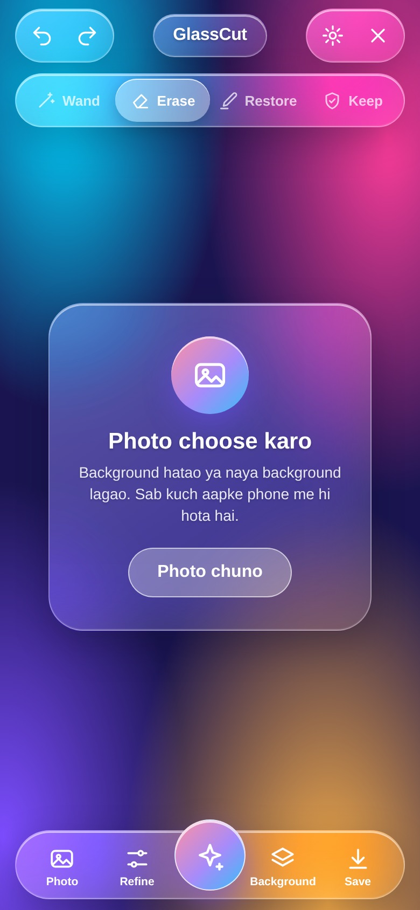 |  | 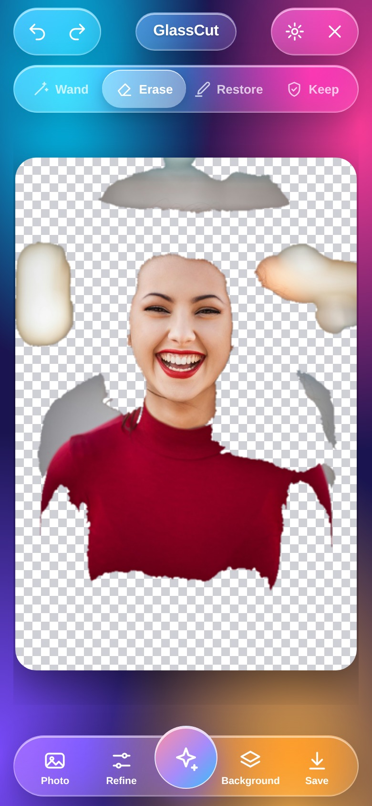 |

| Background sheet | Gradient applied | Remove tools |
|---|---|---|
| 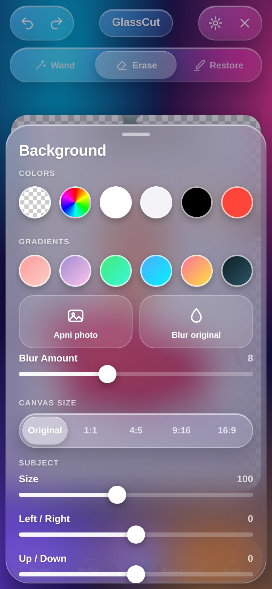 | 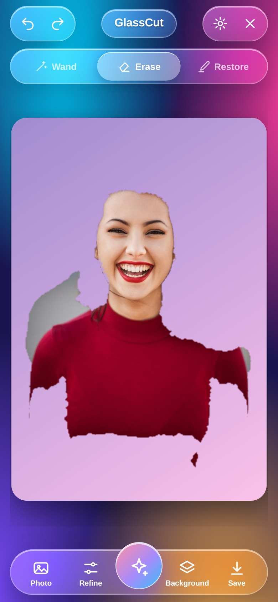 | 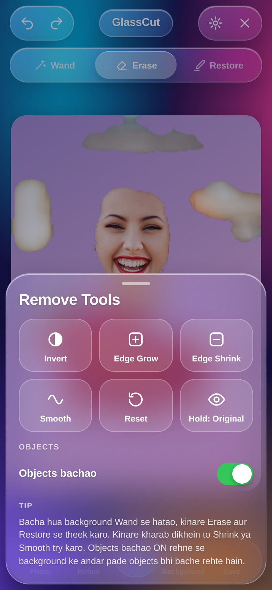 |

| Options | Final render | Saved |
|---|---|---|
| 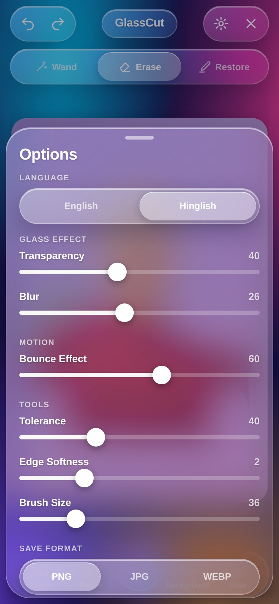 | 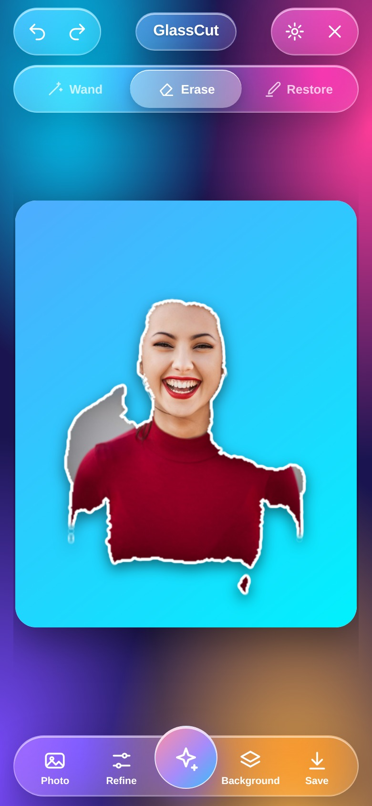 | 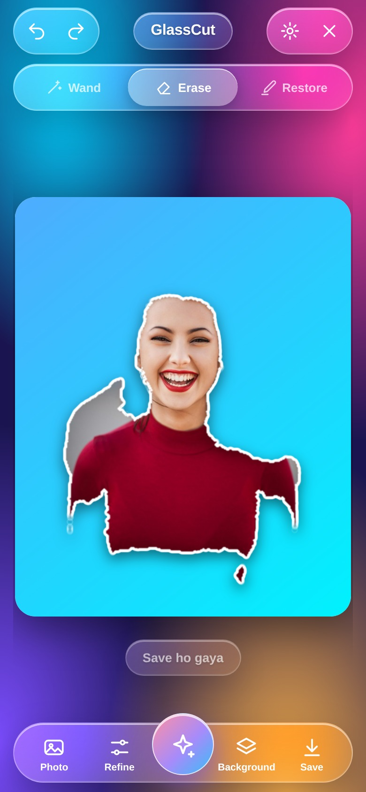 |

---

## What was broken, and what changed

The starting point was a single HTML file that looked finished but didn't work end to end. The design is untouched — same layout, same glass, same springs. Everything below is logic.

### The save path's two biggest allocations, and a leaked WebView

- **The URL fallback decoded the whole payload in one go.** When `toBlob` returns null or never calls back — exactly the low-memory case that made it fail — the fallback re-encodes with `toDataURL` and decodes the base64 with `atob`. That produced one binary string the size of the entire image and one `Uint8Array` to match it, both in a single synchronous step, on top of the data URL that `toDataURL` had just returned. The payload is now decoded in 64 KB slices (65536 is a multiple of 4, so each slice is a whole number of base64 groups and decodes on its own; padding only ever occurs in the last one) and the `Blob` joins the pieces, so the peak is one 48 KB binary string instead of the whole picture.
- **The shell's `writeBase64` did 512 decodes, 512 arrays and 512 writes for a 6 MB save.** Both gallery paths (MediaStore on API 29+, `.tmp`-then-rename on API 24–28) stream the base64 payload through 16 KB slices, and every slice cost one `Base64.decode`, one decoded `byte[]` and one `write()` into the output stream. The slice is now 256 KB: the same bytes, 32 calls instead of 512, on the save path that already holds the WebView's canvas and the page's encoded blob.
- **`onDestroy` destroyed the WebView while it was still attached.** `onRenderProcessGone` already removes the dead view from its parent before destroying it; the normal teardown path did not. A `WebView` destroyed while still in the hierarchy keeps its `AwContents` — and the window it was attached to — reachable, so the activity leaked for the rest of the process's life. It is now removed first, then destroyed, which is the documented order.
- Verified for 1.1.111 (base 1.1.110 vs 1.1.111, headless Chrome, 1400×1200 photo, pixel-area counters on `CanvasRenderingContext2D.prototype`): dragging **Blur Amount** from 8 to 60 in 14 steps on a **colour background** went **13 full frames — `fillRect` 2,18,40,000 px + `drawImage` 81,48,868 px, 26 canvas calls → 0 calls / 0 pixels**, with the canvas hash **exactly unchanged** (`930358fc5183`) — the slider has no effect on any background except "Blur original" and "Blue blur", so those frames were rebuilding a frame that was already there. On a blur background the same drag still repaints and the image still changes. Re-selecting the **already-active language** went **9 → 0 text-node writes and 2.0 → 0.3 ms** (counter on `Text.prototype.nodeValue`, timed inside the click), with the same toast text and a byte-identical `body.innerText`; a real switch (en → hi) still writes its 8 nodes. Nothing else moved: the full 23-checkpoint flow (load + Auto, Wand tap, 14-move erase, undo, redo, Grow, Shrink, Smooth, Invert ×2, Reset, colour background, blur background, 1:1 ratio, two saves to disk, language en/hi, window close/open, undo/redo storm) is **identical at all 20 canvas checkpoints** on seven photos — 1400×1200 JPEG, 1400×1200 transparent PNG, 700×525, 6000×4000, 2000×300, 3×2 and 1×1 — with **zero page errors and zero console errors**, and the saved PNGs are the same bytes.
- Verified for 1.1.109 (base 1.1.108 vs 1.1.109): the fallback decode is measured with a counter on `atob` — one call returning a **208,929-byte** binary string becomes **5 calls, largest 49,152 bytes**, with the total binary bytes still 208,929 and the saved PNG's sha1 unchanged (`1e2c09d0`); forced-fallback saves of PNG, JPG, WEBP and a 1×1 photo are all byte-identical between the two builds. The shell's chunking is measured on a plain JVM with the same body and `java.util.Base64` standing in for the platform decoder: a 6,291,456-byte payload goes **512 decodes / 512 writes → 32 / 32**, a 123,457-byte payload **11 → 1**, a line-wrapped 300,000-byte payload **25 → 2**, and every case decodes to exactly the input bytes at both slice sizes. Nothing else moved: the 28-checkpoint flow (load + Auto, Wand tap, 12-move erase, undo, redo, Grow, Shrink, Smooth, Invert ×2, feather 6, blur background, gradient background, transparent background, PNG/JPG/WEBP to disk, language en/hi, 9:16 and back to original, Reset, window close/open, `trim` + pause/resume, a second photo + Wand + save) is **identical at every checkpoint — same canvas hashes, same sha1 on all five saved files** — and the edge battery (truncated JPEG, a non-image file, a 3000×2000 PNG, four photos uploaded back to back, 14 undos past the end of history, Reset + undo, Invert twice, Keep + Grow, double-tap save, sheet open + Escape, 1×1, 1400×3, 4000×3000, 9:16 and 1:1) matches the base build exactly, with **zero page errors and zero console errors**.

### Refine buttons that could not change a pixel

- **Grow, Shrink and Smooth on a mask that is already uniform.** A freshly loaded photo, and any photo right after Reset, has a mask of pure 255 — nothing removed. `max`, `min` and the blur of a constant mask are that same constant (the blur repeats the edge pixel, so a window sum is still 255·n), so all three buttons produced a byte-identical mask while doing the whole job anyway: a 1.68 MB copy of the mask, a full-canvas scan, the feather blur and a complete render. A 32-bit word scan now recognises the two uniform cases and the press returns before it touches anything, so it also stops putting an empty step on the undo stack. The check runs on every press and leaves the old path alone the moment it finds one differing byte (and whenever `keepMask` is dirty, a preview frame or a slider render is pending, or compare is held).
- **Reset on a mask that is already the untouched photo.** The second Reset — and the Reset of a photo whose Auto removed nothing — copied 1.68 MB, snapshotted another 1.68 MB for the undo stack and re-rendered the whole canvas for a mask that was already there. It now asks `diffBox` (the same comparison undo/redo uses) and, when the two masks are identical, shows the same "Reset ho gaya" and stops.
- **"Blue blur" pressed twice.** The button re-ran the whole portrait pass: mask reset to the photo's own alpha and a full cutout (~700 ms of long task) plus a render, all for a mask it had already produced. A signature of the last successful press (photo token, tolerance, mask version) now short-circuits the repeat; anything that could change the answer — a new photo, a different tolerance, an erase, an undo, the blur slider, Keep switched back on — falls through to the old path.
- Verified for 1.1.107 (base 1.1.106 vs 1.1.107, headless Chrome, 1400×1200 photo, canvas-call counter, median of 3): **Grow 167 → 22 ms, Shrink 156 → 7 ms, Smooth 166 → 5 ms, a repeated Reset 16 → 4 ms, a repeated "Blue blur" 546 → 7 ms**, and every one of them goes from **5,040,000 / 8,678,046 canvas pixels per press to 0** with the canvas hash **exactly unchanged** (that is the point — the skipped work was rebuilding a frame that was already there). The empty undo steps are gone too: four no-op presses followed by Undo now reaches the state before the last real edit, where the base build needed five presses and still had not moved. Nothing else moved: the full 14-checkpoint flow (load/auto, Wand tap, Wand tap on an already-removed pixel, 12-move erase, undo, redo, colour background, Reset, Grow, Smooth, Shrink, Auto, language en/hi, save to disk, window close/open, trim + pause/resume, 320×240 reload + Wand) is **identical at every checkpoint — same hashes, same 78,836-byte PNG** — and so is a Keep + erase + Grow + Reset + Undo + Redo + Restore + Smooth + Invert + compare flow (**13/13 hashes identical**), with zero page errors and zero console errors. The real (non-uniform) paths are untouched: Grow and Shrink after an erase still land on the same hashes as the base build (`af6d9780` / `728f623e`), and so does a Reset that really changes something (`ca8b1c93`).
### The Wand's mask scan, and Grow/Shrink's five loads per pixel

- **The Wand's mask-clear loop read one byte at a time.** A span of background that the flood fills also has to be cleared out of the mask (255 → 0, counted in `cnt`, boxed in `ka`/`kb`). Inside the mask's bounding box that loop walked the span byte by byte — on a 1400×1200 photo a full-background tap is 631,681 of those single-byte tests, and after Auto almost every one of them reads a byte that is already 0. It now reads the mask four bytes at a time through one `Uint32Array` view built once per flood: a word that is zero skips four pixels with a single load, and a word that is not zero runs the same byte loop it always did, so `mask`, `cnt` and the changed box are untouched. The view is built per flood rather than cached, for the same reason `diffView` is not cached: a cached view would pin the previous mask's 1.68 MB buffer after an undo or a new photo.
- **Grow and Shrink loaded five bytes per pixel.** `max`/`min` of a pixel and its four neighbours means `o[i-1]`, `o[i]`, `o[i+1]`, `o[i-W]`, `o[i+W]` — but `o[i-1]` and `o[i]` are the previous pixel's `o[i]` and `o[i+1]`. A sliding window (`l`, `c`, `r`) carries them forward, so each step reads only `r`, `u` and `d`: three loads instead of five, with the same values in the same order.
- Verified for 1.1.106 (base 1.1.105 vs 1.1.106, headless Chrome): the mask-clear loop on a 1400×1200 corner tap went **631,681 byte iterations → 156,992 word iterations + 3,713 byte iterations (160,705, −75 %)**, and the 631,790 / 326,606 figures for the second corner and a subject tap fall to **157,007 / 80,930** the same way. Grow on the same photo walks **1,039,304** interior pixels, so it drops **2,078,608 byte loads per press** (5 → 3 per pixel, −40 %). Every pixel is identical: the full 24-checkpoint flow (load + Auto, Auto again, Wand tap, 12-move erase, undo, redo, undo ×2, redo ×2, Grow, Shrink, Smooth, Reset, colour background, blur background, 9:16 ratio, back to original, PNG to disk, language en/hi, window close/open, second photo) is **identical at every checkpoint — same hashes, same 236,789-byte PNG** — and so are the edge cases: 1×1 (88-byte PNG), 60×40 (1,716-byte WEBP), 4000×3000 → 1400×1050 (31,962-byte JPG, 21,876-byte WEBP), Invert twice, Keep + undo, double-tap save (one file), all with **zero page errors and zero console errors**. `GlassCut.version` without a bridge reported **1.1.102** while the manifest said 1.1.105; the fallback literal is now **1.1.106**.

### Interactions that changed nothing still repainted the whole frame

- **A tap that cannot change a pixel still ran a full render.** Four paths did it: the Wand tapped on a part that is already removed, the aspect ratio that is already selected, the background swatch that is already selected, and the "Blur original" tile when the background is already that blur. In each case the mask, the transform and the background were untouched, so the frame the render produced was byte-for-byte the one already on the canvas.
- **The fix is the same test `save()` already uses** before it decides whether a render is needed: no pending fast preview frame (`raf`), no pending slider render (`rt`), the canvas holds a complete frame (`RFULL`) and compare is off. Only then is the render skipped — otherwise every one of those paths still does exactly what it did before, which is what keeps a pending hard-edge preview from surviving on screen. The Wand path additionally needs `fgSoft === feather`, because otherwise the next frame still has to rebuild `fgc`'s alpha from hard to soft (the same rule 1.1.47 established for `mver`). The swatch path also checks the button's `on` class, so a colour that came from the `#cCol` picker (no swatch marked) keeps the old route.
- Verified for 1.1.105 (base 1.1.104 vs 1.1.105, headless Chrome, canvas-call counter on a 1400×1200 photo): **empty Wand tap — `clearRect` 529,884 px + subject `drawImage` 524,076 px → 0**; **same ratio re-tap — 2 `clearRect` (3,360,000 px) + 2 `drawImage` (1,048,152 px) → 0**; **same swatch re-tap — 2 `drawImage` 1,048,152 px → 1 (524,076 px)**; **"Blur original" re-tap — the click handler's synchronous work 186–200 ms → 0.1 ms, 8 `drawImage` (7,783,462 px) + 2 `clearRect` → 0**. Every one of those interactions leaves the canvas hash **exactly as it was** (that is the point — the skipped frame was identical), and the full 14-checkpoint flow (load/auto, wand tap, 3-move erase, undo, redo, Grow, Invert, blur background, colour background, Reset, Auto again, language toggle en→hi→en, window close/open, 320×240 reload + second save) is **identical at all 14 checkpoints, same 133,292-byte PNG and same 7,193-byte second save**, zero page errors, zero console errors. Save-vs-canvas pixel compare after load, stroke, undo, keep, restore, feather 6, a photo background and Reset is **0 differing bytes on all eight**.

### A dead JPEG surface, and a shell that rebuilt itself for no reason

- **The JPEG flatten surface stayed alive for the whole session on one route.** Saving a JPEG with a transparent background flattens the canvas onto white through `jcv`, a `CW × CH` surface (6.72 MB at 1400×1200). Choosing PNG or WEBP already dropped it, but if the format stayed JPEG and the background became opaque (a colour, a gradient, a blur, an opaque photo), the flatten branch is never entered again — so the surface sat there unused, exactly while a save's own multi-MB blob was alive. `save()` now drops it whenever the save it is about to do will not use it; the existing `if(!jcv)` rebuilds it on the next transparent-background JPEG save, so the file is unchanged.
- **The shell's `configChanges` list was missing every configuration a phone can change while the app is open except the visual ones.** `locale`, `layoutDirection`, `keyboard`, `navigation`, `colorMode`, `fontWeightAdjustment` and `grammaticalGender` were not listed, so changing the system (or per-app) language, switching night/colour mode, or attaching a hardware keyboard or navigation device made Android destroy and recreate the activity — which reloads the WebView, i.e. the chosen photo, the mask and the whole undo history disappear silently. All seven are now handled in place.
- Verified for 1.1.103 (base 1.1.102 vs 1.1.103, headless Chrome): an instrumented build exposes `jcv`'s size. JPEG save on a transparent background → `jcv` `[1400, 1200]`; then a white colour background (opaque) with the format still JPEG → the base build still holds `[1400, 1200]` (6.72 MB dead), this build holds `null`. Not one byte of output changed: all three saves are the same **41,778-byte JPEG, sha1 `fc013de800d5`**, and going back to a transparent background rebuilds the surface and produces that same file again. The manifest side is checked on the built APK with `aapt2 dump xmltree`: `configChanges` went **0x40001FA0 → 0x5000FFF4** — exactly `locale` 0x4, `keyboard` 0x10, `navigation` 0x40, `layoutDirection` 0x2000, `colorMode` 0x4000, `fontWeightAdjustment` 0x8000 and `grammaticalGender` 0x10000000 added, with the eight previous flags unchanged. The 20-checkpoint flow (load/auto, wand, 14-move erase, undo, redo, Grow/Shrink/Smooth/Invert ×2, blur background, gradient background, Reset, colour background, PNG to disk, language toggle, window close/open, 320×240 reload + second save) is **identical at all 20 checkpoints, same 211,561-byte PNG and same 26,573-byte second save**, zero page errors, zero console errors.

### Whole-mask byte loops still walked one byte at a time

- **The three loops that touch every mask pixel ran a byte per iteration, and two of them wrote the same constant value per pixel.** `layer()` asks "is the whole mask 255?" before every full feather-blur rebuild; Invert flips all `W*H` bytes; and `cutout()`'s full-resolution pass writes `seen = generation` and `lev = 0` for every pixel of every background run it queues. All three are pure per-byte work with no byte-internal meaning, so they now run on 32-bit words: `w !== 0xFFFFFFFF` for the check, `0xFFFFFFFF - w` for the flip (that subtraction borrows nothing — it *is* the word's bitwise NOT, so each byte becomes exactly `255 - b`), and two `memset`s (`seen.fill`, `lev.fill`) instead of two stores per pixel.
- Verified for 1.1.102 (base 1.1.101 vs 1.1.102, headless Chrome): in a microbenchmark on a 1400×1200 mask the all-255 scan went **2.1 ms → 0.5 ms** and Invert **2.1 ms → 0.6 ms**; the boundary-run writes went **2.0 ms → 1.2 ms** per 480,000 pixels. Every one of them is byte-identical — mask diff 0 over 1,680,000 bytes, `cnt` 439,780 on both, `seen`/`lev` diff 0 — because `mask.length` is not a multiple of 4 only for the last 0–3 bytes, which keep the old byte path, and the queue is still filled in the same ascending-`x` order. End to end, the JS stages of a cutout (`match + pass1 + pass2 + islands + snap`, minimum of 15 Auto presses on 1400×1200) went **27.2 / 29.0 ms → 22.5 / 21.7 ms**. The view is built per call, not cached: a cached `Uint32Array` would keep the previous mask's 1.68 MB buffer alive after undo or a new photo — the same pinning that was fixed for `DVA`/`DVB`.
- The 22-checkpoint flow (load/auto, wand, 14-move erase, undo, redo, Grow/Shrink/Smooth/Invert ×2, blur background, gradient background, Reset, colour background, PNG to disk, language toggle, window close/open, 320×240 reload + second save) is **identical at all 22 checkpoints with the same 44,890-byte PNG (sha1 `29ad73ec92…`) and the same 3,018-byte second save**, zero page errors, zero console errors.

### The permission result never reached the superclass, and could NPE

- **`onRequestPermissionsResult` was the one result callback in the shell that did not forward to `super`** — `onActivityResult` was fixed for exactly this earlier, and this call site was missed, so `ActivityResultRegistry` / fragment dispatch never heard about a storage-permission answer.
- **Its grant test was `res.length > 0 && res[0] == GRANTED`.** The platform may answer an interrupted request with an empty — or absent — array, and `res.length` on a null array is a `NullPointerException` on the UI thread, i.e. a crash on the API 24–28 save path (the only path that ever asks for a permission).
- Verified for 1.1.102: the test is now the static `permGranted(int[] res)` (kept free of Android types, like `isEmptyWrite` / `isStalePending`, so the same body runs on a plain JVM). The JVM test passes — `null → false`, empty → `false`, `DENIED → false`, `GRANTED → true` — and the old expression throws `NullPointerException` on `null` in the same test. A missing answer now fails the save exactly like a denial, so the page still shows its own long-press overlay.

### Auto re-downscaled the same photo on every press

- **The coarse grid Auto floods was rebuilt from scratch on every press, from a photo that had not changed.** `cutout()` first halves the working photo into a 700×600 RGB grid (`boxDown`) and floods that; its only inputs are the photo's RGB pixels and its size, and neither changes between presses — `od` is written in exactly one place (`drawPhoto`), and `layer()` only ever touches the alpha byte. So every repeat Auto (change the tolerance, or erase something and tap Auto again) spent 16–21 ms rebuilding a byte-identical grid. The downscale is now cached against a photo token (`PTOK`, bumped only by `drawPhoto`), and `SD = null` on a new photo or on `GlassCut.trim()` still falls through the same length guard, so the cache can only ever be dropped, never stale.
- Verified for 1.1.101 (base 1.1.100 vs 1.1.101, headless Chrome): on an instrumented build (a timer wrapped around `boxDown`, then 8 × erase-stroke + Auto cycles on a 1400×1200 photo) **`boxDown` calls went 7 → 1 and its total time 150.7 ms → 28.6 ms** (each warm call is ~21 ms, so six calls ≈ 126 ms saved), with the **median Auto press 61.7 ms → 28.1 ms**; on a 4000×3000 source photo (working size 1400×1050) the same 7 → 1 calls, 148.4 ms → 20.9 ms, median 100.6 ms → 52.4 ms. The result is byte-identical — both builds end on canvas hash `2435957686`. The cache is proven to invalidate on a same-size new photo: loading `t.png` → `t2.png` → `t.png` (both 1400×1200) gives Auto hashes `1779089996 / 2727522054 / 1779089996`, and `2727522054` is exactly what `t2.png` gives in a fresh page. The 19-checkpoint flow (load/auto, wand, 14-move erase, undo, redo, Grow/Shrink/Smooth/Invert/Reset, colour background, PNG to disk, language toggle, window close/open, 320×240 reload) is **identical at all 19 checkpoints with the same 40,564-byte PNG (sha1 6b0dbce9…)**, the same holds for a 4000×3000 and a 320×240 photo, and the edge battery (save-vs-canvas pixel compare = 0 diff, undo-all/redo-all, language toggle, ratio 1:1 round-trip, slider + save, two fingers, window closed mid-stroke, empty wand tap, 1×1 photo) is unchanged. Zero page errors, zero console errors.

### The stale-save sweep could never find its own rows

- **`sweepPending()` — the pass that reclaims `IS_PENDING=1` MediaStore rows left by a killed save — queried `RELATIVE_PATH = 'Pictures/GlassCut'`.** MediaStore normalises `RELATIVE_PATH` to always end with `/` (inserting `Pictures/GlassCut` stores `Pictures/GlassCut/`), so that equality matched nothing and the sweep was dead code: every orphaned pending row stayed invisible to the gallery, unfindable by the user and unreclaimed, for ever. The selection is now `RELATIVE_PATH IN (?,?)` with both forms, so it no longer depends on whether the provider normalises.
- Verified for 1.1.101: the predicate itself was run against a SQLite table holding the normalised value (`Pictures/GlassCut/`, `IS_PENDING=1`) — `=` returns **0 rows**, `IN` with both forms returns **1**, and a neighbouring `Pictures/GlassCut2/` row is matched by neither (so the sweep still cannot touch another folder's files). The APK compiles and links with the new selection (`build.sh`, versionCode 101).

### The page's own version fell behind again

- The fallback literal behind `GlassCut.version` is only read when there is no shell bridge (browser, preview) or `versionName()` returns empty — and it had slipped to `1.1.99` while the manifest was at `1.1.100`, the same drift fixed in 1.1.99. It now matches the manifest.
- Verified for 1.1.101: `GlassCut.version` with no bridge reads **"1.1.99" → "1.1.101"** (base vs this build), with zero page errors.

### A failed save kept quiet

- **Three of the five ways a save can fail ended with no message at all.** The page says "Save nahi hua" when the shell reports a failure through `GlassCut.failed()` (the API<29 permission route), but the other three routes — the shell's `saveImage()` returning `err:…`, a `FileReader`/6 s-watchdog failure on the same bridge, and the last-resort download when both `navigator.share` and the `<a download>` click fail — only opened the long-press overlay. Same failure, two different outcomes: the user saw a picture appear over the editor and, in the download case, had nothing at all to tell them the file never reached the gallery. All three now say the same thing, once, in the language the user picked (`Save nahi hua` / `Save failed`), and the overlay still appears with the encoded blob.
- Verified for 1.1.100 (base 1.1.99 vs 1.1.100, headless Chrome): trimming the caches (`GlassCut.trim`, which Android sends on pause and on memory pressure) used to keep the original-photo surface (6.72 MB at 1400×1200) and the cutout's island run table (~1.7 MB) alive even though both are pure caches that are rebuilt on demand. Measured on an instrumented build (cache snapshot before/after `GlassCut.trim()` on a 1400×1200 photo with a blur background): **11,487 KB → 3,281 KB retained, i.e. 8,206 KB (8.0 MB) less**, leaving only the photo state and the two masks. The 23-checkpoint flow gives **byte-identical canvas hashes at every checkpoint (10 distinct states) and the same 313,638-byte PNG (sha1 4476c7a2…)** on both builds, the trim-flow (compare after trim, blur/blue-blur background after trim, Auto after trim, undo after trim, save after pause/resume, same-size and 320×240 reload) is byte-identical too (246,750-byte PNG, sha1 975eb027…), and a semi-transparent PNG renders identically after a trim (the surface is only dropped for opaque photos, where the rebuild is exact). Zero page errors, zero console errors.
- Verified for 1.1.99 (base 1.1.98 vs 1.1.99, headless Chrome, a fake `GlassCutAndroid` bridge and a patched `HTMLAnchorElement.prototype.click`): with the bridge returning `err:disk` the toast went **empty → "Save nahi hua"**, with a bridge that throws **empty → "Save nahi hua"**, and with no bridge and a failing download **empty → "Save nahi hua"**; the overlay was shown before and after in all three, `saveImage()` returning `ok:…` still shows **"Save ho gaya"** with no overlay, and `ok:pending` followed by `GlassCut.failed()` still shows exactly one message. The 21-checkpoint flow (load/auto, wand, 12-move erase stroke, undo, redo, Grow/Shrink/Smooth/Invert/Reset, colour + gradient + blur backgrounds, PNG save to disk, language toggle, window close/open, then 1400×1050 / 320×240 / 1×1 / 1400×3 photos) gives **byte-identical canvas hashes at every checkpoint, the same 424,744-byte PNG, and zero page errors / zero console errors** on both builds; the edge battery (undo depth, pointer leaving the canvas, `pointercancel`, undo mid-stroke, double save, ratio change + undo, WEBP/JPEG/PNG saves, 1×1 photo, closing the window mid-stroke) is unchanged.
- Also fixed on the same pass: the page's fallback version literal was still `1.1.95`, so with no bridge (browser, preview) or an empty `versionName()` the page reported a version three builds old. It now matches the manifest — `GlassCut.version` without a bridge reads **"1.1.95" → "1.1.99"**.

### The feather mask was blurred over the whole canvas

- **Every time the soft mask had to be rebuilt it blurred all 1.68 M pixels of a 1400×1200 photo, when only the subject's box matters.** The box blur has radius `feather`, so it cannot reach further than `feather` pixels past the mask's bounding box, and outside that box the mask is exactly 0 — so the result outside `MB ± feather` is 0 too. That was the one place the code did not use that fact: a fresh `softM` (new photo, first frame after `GlassCut.trim()`, a size change, or any state without a `SBOX`) went straight to `blurRect(mask, feather, 0, 0, W-1, H-1, softM)`. It now blurs only `MB ± feather`, memsets the buffer first when it is being reused (1.68 MB, ~0.7 ms) so nothing stale survives outside the box, and skips the memset when the box already covers the canvas because the blur writes every byte. `SBOX` becomes that box, so the alpha upload, the `putImageData` and the exact-`SUB` scan after it all shrink with it.
- Verified for 1.1.98 (base 1.1.97 vs 1.1.98, headless Chrome, instrumented builds that expose `softM`, `SBOX`, `MB` and `SUB`): a 25-checkpoint differential flow on 1400×1200 — load/auto, feather 2/4/6, Grow ×2, Shrink, erase, undo, redo, Smooth, Invert, wand, Reset, Blue blur, colour background, and `GlassCut.trim()` seven times in between — produced an **identical canvas hash, `softM` hash, mask hash, `SBOX`, `MB` and `SUB` at every checkpoint** (the two dumps diff to nothing), and the ordinary 14-step flow (load, auto, wand, erase, undo, redo, background, Reset, PNG save to disk, language toggle, window close/open, save again) gives the same 14 canvas hashes and the same 126,318-byte PNG on both builds, with zero page errors and zero console errors. A 1×1, a 7×5, a 4000×3000 and a 6000×5143 photo all load to the same canvas sizes as before with no error. Measured on the same photo (feather 4, MB 515,245–886,1106, median of 9 runs): the first feather frame after `GlassCut.trim()` went **96.5 → 65.6 ms (−32%)**, the Grow that follows a trim **114.7 → 104.6 ms**, the Shrink **110.8 → 97.9 ms**; the blur itself is 37–68 ms over the whole canvas versus **6.2–7.6 ms** over the box. The cache-staleness oracle (force a full rebuild of the feather mask, alpha layer and canvas, then check the screen did not move) stayed 10/10 clean.

### Undo/redo could clip the subject

- **Redo could bring back the right mask and still draw the wrong picture** — after an undo/redo cycle that had passed through a Keep-painted state, the last Redo restored a mask that was byte-identical to the original (checksum `2533133719` on both sides) yet left 7,754 canvas pixels different (box 563,503–894,722), and the next Undo left 7,585. The cause was in the exact-`SUB` scan at the end of the alpha upload: it clipped its scan box to the *previous* `SUB` on the reasoning that alpha outside the uploaded box cannot have changed, so the previous `SUB` already bounds it. That reasoning does not survive `hist()`: undo/redo replaces the whole mask, one too-small `SUB` then sticks for every later frame, and `drawSubj` draws the subject from that `SUB`'s source rect — so the subject gets cut. The clip is gone; the scan box is now the same box the upload used (`SBOX` with feather, `MB` without), and the part that was just uploaded is still skipped, so only the remainder is read.
- Verified for 1.1.97 (base 1.1.96 vs 1.1.97, headless Chrome): the failing sequence — 1400×1200 photo, erase, restore, Keep stroke, Edge Grow, Edge Shrink, Smooth, then 6× Undo and 6× Redo — went from 7,754 differing pixels to **0**, and the following Undo from 7,585 to **0**. On the ordinary flow (load/auto, wand, erase, undo, redo, reset, colour background, PNG save to disk, language toggle, window close/open, save again) all 14 canvas hashes and the saved PNG are byte-identical on both builds (84,426 bytes each), with zero page errors and zero console errors; the same holds for the wide feature flow (Keep, Grow/Shrink/Smooth/Invert, Hold: Original, outline 20, depth 60, tilt 20, 4D motion 50, own background photo, new photo, save) and the save matrix (PNG/JPG/WEBP × opaque/alpha photo, all six files land with the right format, size and corner pixels). Cost of the wider scan: none measurable — 30 stroke releases on 1400×1200 took 1103/1000 ms on the base build and 958/887 ms on this one.

### Save was fake
The old `save()` called `window.claude.use('downloads')` — an API that only exists inside one particular preview environment. Everywhere else it silently fell through to an overlay that told you to *long-press the image and save it manually*. No file was ever written.

| Before | After |
|---|---|
| 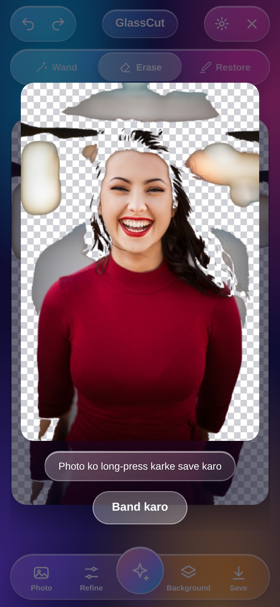 |  |

Now `save()` picks the best real path in order:

1. `GlassCutAndroid.saveImage()` — the APK writes into the gallery through MediaStore (`Pictures/GlassCut`), with a storage-permission request on Android 7–9.
2. Web Share API on phones, so iOS Safari can put the file in Photos.
3. A normal `<a download>` blob download on desktop.
4. The long-press overlay only if all three are unavailable — which is now rare.

It also falls back to PNG if the browser refuses `image/webp`, instead of failing with "Save nahi hua".

### Auto-removal left half the background behind
The old algorithm compared every pixel to one fixed colour with a single tolerance. On a portrait with a blurred backdrop it removed the flat areas and left every bokeh blob floating in the cutout.

The new cutout is coarse-to-fine:

1. Downscale 4× — a blurred background collapses into one nearly uniform colour.
2. Flood the border colour model at low resolution, then **drop leftover islands**: any foreground blob smaller than half the largest one becomes background again.
3. Upsample the mask and run a **level-limited flood at full resolution** (max 7 px) so the edge snaps to the real pixel boundary instead of the blocky 4× version.

Opaque pixel coverage on the same test photo: **70 % → 31 %**, with the subject intact and no bokeh left over.

| Before | After |
|---|---|
| 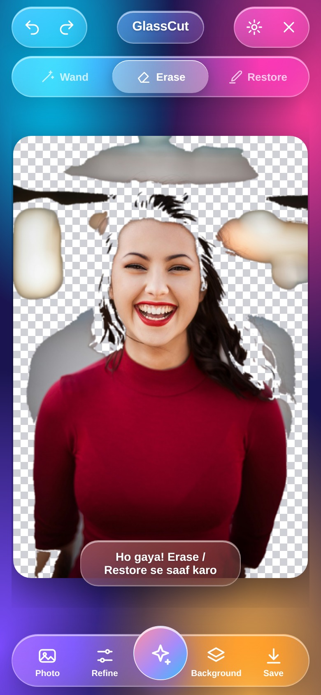 |  |

## Objects inside the background

The first version kept only the **largest** blob and threw away every other island it found. On a photo with a plant, a stool and a ball, the plant survived and everything else vanished — the exact thing a background remover must not do.

1.0.1 keeps them. Two changes:

1. **A second flood pass at 1.7× tolerance**, seeded from the background that was already removed. Shadowed patches, bokeh rims and other off-shade pieces of the *same* background get absorbed, because they sit within reach of a background colour.
2. **A smarter island rule.** Under the new *Objects bachao* switch (on by default) an island is only dropped when it is a speck (under 0.15% of the photo) or when its average colour is within 1.15× tolerance of a background colour — i.e. it really is leftover background. Anything else survives, whatever its size or position.

| 1.0.0 — only the plant survived | 1.0.1 — everything survived |
|---|---|
| 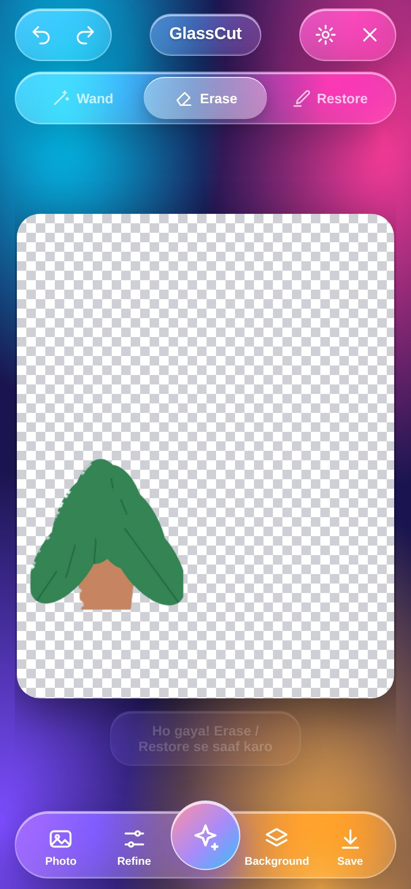 | 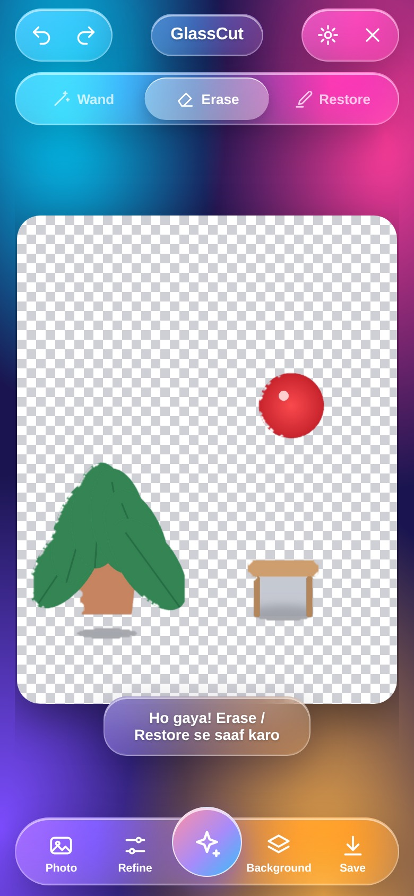 |

And once the background is gone, the new one goes behind **every** object, not just the main subject:

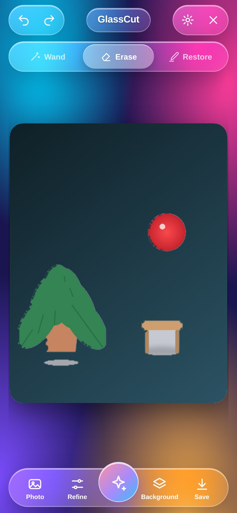

**The switch.** *Refine → Objects bachao*. Leave it on and the app keeps everything that isn't background; turn it off for the old behaviour, where only the main subject is kept. Turn it off for portraits where you only want the person and the bokeh behind them can go. The switch lives in the Refine sheet, so the top bar and the dock are unchanged.

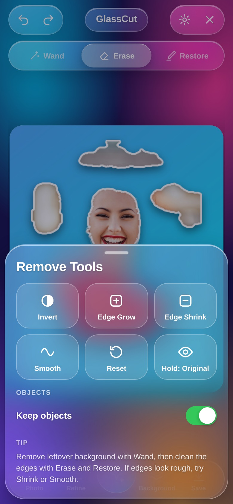

## 3D tilt, depth and 4D motion

Three new sliders under **Options → 3D & Depth**. All three are baked into the saved file, not just the preview.

| Control | What it actually does |
|---|---|
| **Depth** 0–100 | Subject scales up to +7%, the drop shadow deepens and moves, and a radial vignette darkens the background. This is what makes the person read as a separate layer instead of a sticker. |
| **3D Tilt** −30…+30 | A perspective shear around the subject's own centre — a vertical-axis rotation, `cos` on the horizontal scale plus a `sin` shear, so it reads as 3D rather than as a skew. |
| **4D Motion** 0–100 | Live parallax. The subject layer and the background move in opposite directions. Driven by `deviceorientation` when the phone reports it, otherwise a slow automatic sway. Runs at ~16 fps so it costs nothing while you edit. |

| 3D & Depth controls | Result with depth 78, tilt 20, motion 60 |
|---|---|
| 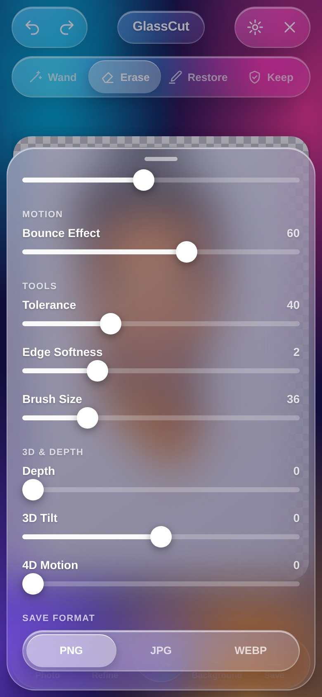 | 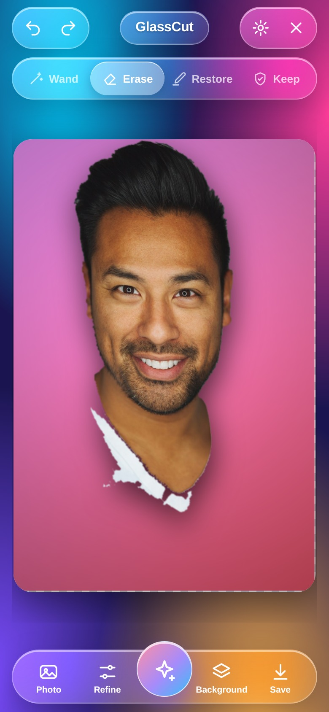 |

Save captures whatever the effect is showing at that moment, so the exported PNG/JPG has the tilt, shadow and vignette in it.

## Blue blur — one tap, only the person

The quickest result in the app, and the one that survives a bad cutout.

**Background → Blue blur.** It does three things at once:

1. Sets the blur amount to 48 — a 1/79 downscale, so the original background becomes an unreadable wash.
2. Lays a strong blue tint (`#0a5cff` at 72%) over it.
3. Switches to subject-only mode and re-cuts, so leftover background islands are dropped instead of floating in the blue.

| Background sheet | Result |
|---|---|
| 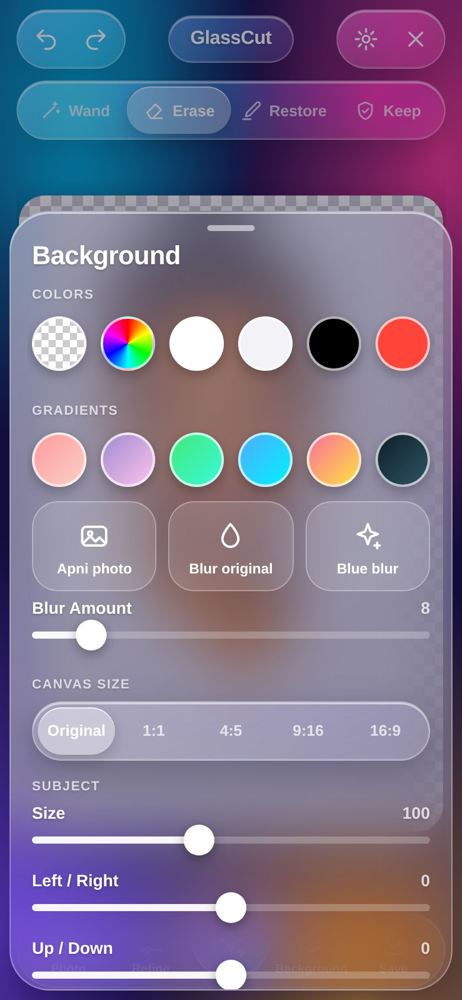 | 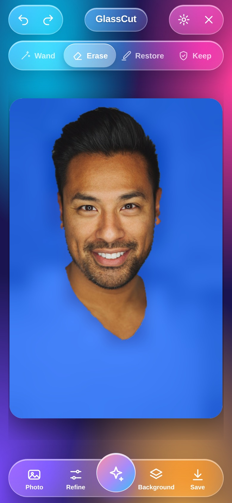 |

The Blur Amount slider now goes to **60** instead of 20, so "Blur original" can also be pushed until nothing is recognisable — without the blue.

Save works the same as always: PNG, JPG or WEBP into `Pictures/GlassCut`.

## Background change is automatic

The complaint that started 1.0.3: *pick an image, change its background, and leave the person exactly as they are.* Two things were in the way.

**Auto did not run on its own.** You had to press Auto before the Background sheet did anything — until then the new background was painted *behind an opaque photo*, so nothing appeared to change. Now the cutout runs the moment a photo loads. Pick photo → background already gone → open Background → pick a colour, gradient, blur or your own image. One tap, and the person is untouched.

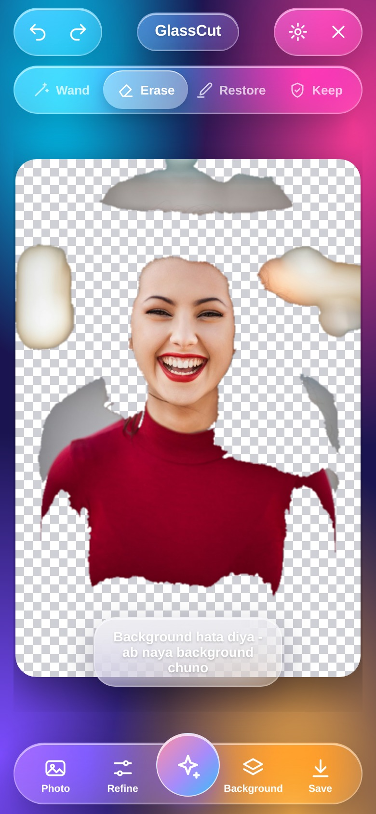

**The edge was being eaten.** The final edge-snapping pass could creep 7 px into the subject at a soft boundary, which is what chewed hair and left a white halo around faces. It is now capped at 3 px with a tighter colour step, and the coarse pass runs at half resolution instead of a quarter.

| before 1.0.3 — halo, chewed edge | 1.0.3 — clean edge |
|---|---|
|  |  |

**What still needs a hand.** If the subject's hair or clothing is almost the same colour as the background, no colour-based flood can tell them apart — that is a job for the **Keep** brush: paint the hair once, press Auto, done. Honest limit, not a bug.

### The Keep brush — the guaranteed one

Automatic removal is a guess. *Keep* is not. Paint over anything with the Keep tool and it is locked: the flood cannot cross it, Auto cannot take it, Grow/Shrink/Invert/Smooth all respect it. It survives even at maximum tolerance.

| Keep selected, painted over the object | Auto at tolerance 110 — object survives, everything else gone |
|---|---|
| 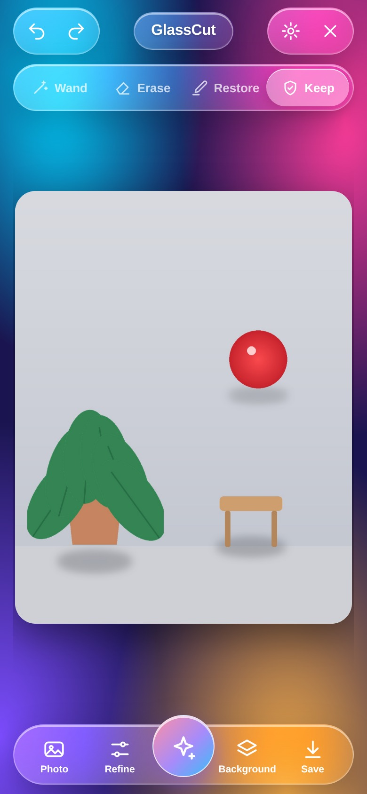 | 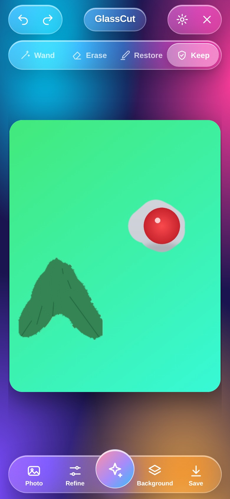 |

What you paint stays, halo included — so paint tight. If you painted too much, switch to **Erase** and go over the extra: erasing clears the protection as well as the pixels. Keep strokes are part of the undo history, so `Undo` takes the protection back too.

**How to use it for your case:** Keep the object → Auto → the object and its own edges are untouched → *Background* → pick a colour, gradient or photo. The new background goes behind the object.

Honest limitation: a soft out-of-focus highlight and a soft-edged object look identical to a pixel test. With the switch **on**, an out-of-focus highlight in the background is kept, because the app would rather keep an object than delete one. Tap it away with the Wand — that is what the Wand is for.

### Smaller fixes

- **Undo/redo could corrupt state** — the edge-smooth pass read from the live mask while writing to it.
- **Canvas upscaling** — picking a crop ratio forced a 1400 px canvas even for a small photo, so the subject went soft. The canvas is now capped at the photo's own long edge.
- **Brush ring was the wrong size** — it was drawn in screen pixels from an image-pixel radius, so it ballooned on small canvases. It now tracks the live zoom.
- **Wand left an empty undo step** when nothing matched, so one tap of Undo appeared to do nothing.
- **Blur background re-rendered every frame** — now cached by canvas size and blur amount.
- **Language toggle ate whitespace** — text nodes were replaced with trimmed strings, shifting the layout on every switch. Only the words are swapped now.
- **Pointer capture was never released**, so a stroke could stick after leaving the canvas; `pointerleave` now ends it.
- **Memory** — undo history trimmed to 15 full-resolution masks.
- **Objects in the background were deleted** — the island filter kept only the biggest blob. Fixed in 1.0.1, see above.
- **Outline redrew the whole canvas** — the edge outline drew the full W×H silhouette 16 times per frame even when the subject covered a third of the canvas; it now draws only the subject's bounding box.
- **Idle 4D Motion burned frames** — with the gyro still, the page re-rendered the same frame 16 times a second; it now renders only when the parallax offset actually changes.
- **Safe areas** — the page reads `--sat` / `--sab` CSS variables, which the Android shell feeds from real window insets, so the header clears a notch and the dock clears the gesture bar.
- **Feather re-blurred the whole canvas** — with Edge Softness above 0, every Wand / Auto / Grow / Smooth / Undo rebuilt the soft mask over all W×H pixels even though the mask only has content inside the subject's box. It now rebuilds only that box (+radius) and memsets the rest, and undo/redo keep the mask box instead of resetting it to the whole canvas: measured in headless Chrome at 1400×1200 with softness 6, one rebuild 73.3 ms → 20.2 ms (−72%), an Edge Grow press 107 ms → 72 ms.
- **Opaque background cleared twice** — with a colour or gradient background and no parallax, every frame cleared the full canvas and then painted over all of it. The redundant clear is gone: 1,680,000 → 0 clearRect pixels per frame, identical canvas hash.
- **A photo that never decodes left the app stuck** — if the WebView neither fires `onload` nor `onerror` (corrupt file, decode OOM), nothing happened at all before: no toast, no photo. There is now a 20 s watchdog, and a slow first decode can no longer overwrite the photo the user picked after it.
- **Auto's downsample ran a generic loop for a 2×2 block** — the cutout shrinks the photo by half, so nearly every output pixel is the average of exactly four source pixels, yet each one re-ran the generic inner-loop bounds and did three divisions. Those blocks now take four straight loads and a 1021-byte table built through `Uint8ClampedArray` (so it rounds exactly like `r/4`): at 1400×1200 the downsample went 17.9 ms → 6.9 ms (−61%) and the whole Auto press 116.5 ms → 99.4 ms (−15%).
- **The Keep tool's protection scan covered the whole canvas** — `enforce()` walked all W×H pixels on every stroke release, Grow, Smooth, Invert, Reset and Auto, even though only the painted keep area can be protected. It now keeps a conservative box of that area (like the mask box) and scans only that: 1,680,000 → 5,325 pixels for a single Keep stroke (−99.7%).

- **The render loop allocated a string every frame** — `layer()` built its cache key as `mver + 's' + feather` (two concatenations when Edge Softness was on, one otherwise) just to compare it with the previous key. The two values are numbers, so they are now compared as numbers (`fgVer`/`fgSoft`, −1 meaning "hard edge"): the key expression went 98.6 ns → 1.1 ns per frame and allocates nothing. The `requestAnimationFrame` callback had the same problem — a fresh closure per scheduled frame — and is now one named function: 81.0 ns → 2.5 ns per frame. Measured with CDP's heap profiler at sampling interval 1 during a 300-move erase stroke at 1400×1200, the bytes allocated inside `layer()` went 65,536 → 72 and the whole stroke's JS allocation 131,220 → 65,824 bytes (−49.8%).
- **Every pointermove allocated two arrays** — `pt()` returned a fresh `[x, y, scale]` and the move handler immediately copied it into another `last = [p[0], p[1]]`. Both are now one reused scratch array and two scalars: 85.8 ns → 4.3 ns per move, 800 fewer arrays in a 400-move stroke.
- **A share sheet that never answered bricked Save** — if `navigator.share` never settles (some WebViews and shells), the `await` hangs, `finally` never runs and `saveBusy` stays `true` for the rest of the session, so no later save does anything. This is the same bug that was fixed for `toBlob` and `FileReader` earlier. There is now a 20 s guard that releases the flag; if the share later resolves the same "Saved" toast appears, if it rejects the download fallback runs. With a stubbed share that never settles, the previous build wrote 0 files for three saves in a row and the new one writes the file on both later saves (18,013 B PNG, magic `89504e47`).

- **JPG saved a black box where the background was transparent** — the flatten pass only ran when the background was "none", so a transparent PNG picked as "My photo" (or a Blur background over a photo with transparent edges) came out black in the file while the screen showed the checkerboard. It now flattens whenever the composite is not opaque, on white, exactly like the no-background case: corner pixels of a 1400×1200 JPG go from `(0,0,0)` to `(255,255,255)` and the subject pixel is unchanged; every opaque case still saves byte-identical files.
- **Two full-size flood stacks for one job** — the wand's stack (M ints) and the cutout's stack (max(N,M) ints) were separate `Int32Array`s even though they never run at the same time, and the cutout's `vis` array was a third. They now share one buffer and `vis` is gone: live typed-array memory after one wand tap drops from 47.46 MB to 39.84 MB (−7.61 MB, −16%) at 1400×1200, and the same −7.7 MB is still saved after switching to a 320×274 photo, so the old buffers are not kept alive.
- **Auto's colour test ran inside the flood** — the four-reference, two-threshold test sat in both BFS passes, interleaved with queue and `vis` traffic. Both answers are now precomputed in one linear pass over the grid (bit 0 strict, bit 1 loose-only) and the floods do a single bit test. Interleaved base/new in one browser (min of 14, measured twice): pass 1 13.2/12.7 → 4.6/5.3 ms (−65%/−58%), pass 2 3.4/3.9 → 2.2/2.5 ms (−35%/−36%), the new prepass costs 3.2–3.3 ms, and the whole Auto press 36.8/35.4 → 29.0/31.1 ms (−21%/−12%).

- **Every scratch buffer was thrown away on each photo load** — the cutout's stack (`STK`, 5.88 MB), its seven grid buffers, the blur tables and the box-down output all have their own size guard and reallocate themselves when a size really changes, so dropping them on load only bought a reallocation 30 ms later. A same-size reload (two photos from the same camera — the common case) now reuses them: typed-array allocations on a 1400×1050 same-size reload go from 26 allocations / 17,353,876 bytes to 0 / 0, and the first wand tap after that reload no longer rebuilds the 5.88 MB flood `vis`. Buffers that really do describe the previous photo (the stroke deltas `DIRT`/`SDIRT` and the subject box `SUB`) are still dropped.
- **Setting a canvas to the size it already has still threw its backing store away** — `origc`/`fgc`/`outc` were resized on every photo load and `cv`/`tmp` on every `setSize`, which is 5.88 MB per surface at 1400×1050 even when the value is unchanged. They are now only resized when the size actually changes, and cleared instead (`clearRect` on `origc` matters: without it a transparent PNG would blend over the previous photo's pixels). Canvas width/height sets on a same-size reload: 12 → 2 (the two left are the 1×1 background canvas), and re-tapping the crop ratio that is already selected: 4 → 0.
- **A stroke that changed nothing still rendered a frame** — `stroke()` bumped `mver` and scheduled a render on every `pointermove`, even when the brush touched only pixels that were already erased (the most common thing an erase stroke does). A frame that redraws an identical canvas is pure waste: with 20 erase moves inside an already-erased band (one frame apart) `putImageData` goes from 21 to 0 and `clearRect` from 21 to 1, with an identical canvas hash.
- **…and releasing such a stroke rendered the whole canvas once more** — the pointer-move side was fixed earlier, but `end()` still ran a full render on release unconditionally, so every tap on an already-erased area cleared and redrew the whole canvas for nothing. Now the release render only happens when the stroke actually changed a mask byte (or a fast preview frame is still pending, which still has to be replaced by the soft final one). Measured by instrumenting the 2D context: an empty tap went from 1 `clearRect` (1200x900 = 1,080,000 px) + 1 full-subject `drawImage` to 0 draw calls, and the forced raster flush after it from 1.1-1.5 ms to 0.0 ms, with the canvas hash unchanged on all 8 taps.
- **Fast flicks erased a straight line instead of the finger's path** — a touchscreen samples at 120-240 Hz but `pointermove` arrives once per frame, and only the last sample was used, so everything in between was thrown away: the brush interpolated a chord between two samples 40-100 px apart. `getCoalescedEvents()` is now replayed sample by sample through the same `stroke()` (the dispatched event is still processed last, and its duplicate stamp is dropped by the existing `stX/stY` guard). For one move whose coalesced list holds a 7-sample arc, the erased area goes from 61,569 to 70,887 px and 43,939 px that the finger really crossed are no longer left behind; with no coalesced list (mouse, synthetic events, old WebView) the code path is exactly the old one — every canvas hash in the flow suite is byte-identical.

- **PNG photos came out the wrong shape** — `imgDims` read the PNG `IHDR` width/height little-endian, but PNG is big-endian (JPEG and WebP/GIF really are little-endian, which is why only PNG broke). The two byte-reversed numbers land in an arbitrary ratio, so any PNG that is not exactly 1400 px on its long side was handed to `createImageBitmap` with the wrong resize box: an 800×600 PNG became a 509×1400 canvas — a landscape photo stretched into portrait, upscaled 1.75×, 712,600 px where 480,000 would do — and a 1×1 PNG became 1400×1400. Across 9 PNG sizes (1×1, 7×1400, 1400×1, 233×317, 800×600, 1200×1200, 1400×1400, 1500×1000, 3000×2000) 8 of 9 canvases were wrong before and 9 of 9 are exact now; 800×600 loads in 1488 ms instead of 2257 ms at peak RSS +37 MB instead of +42 MB, and 3000×2000 in 1316 ms instead of 1593 ms at +63 MB instead of +77 MB. JPEG/WebP/GIF parsing is untouched — a 1400×1050 JPEG flow is byte-identical.
- **Lossless WebP photos were decoded at full size** — `imgDims` knew `VP8X` and lossy `VP8`, so a `VP8L` (lossless) file fell through to the old full-size `` decode — exactly the path 1.1.58 removed for big photos, and lossless is what most "save as WebP" tools write. The `VP8L` size is 14+14 bits after the 0x2F signature byte and is now read from the header: a 6000×4000 lossless WebP goes from 6392/6679/7583 ms to 3617/3778/3693 ms (three runs each, ~45% faster, `createImageBitmap` 0 → 1 call) with the same 1400×933 canvas. Peak RSS only moves +218 → +203 MB, because Chromium still decodes the whole file before resizing — the win here is time, not memory.

- **The language toggle re-walked the whole DOM every time** — `applyLang` built a fresh `TreeWalker` and ran `trim()` + `String.replace()` on all 197 text nodes per toggle. The markup is static, so the list is now built once and a toggle is a plain `nodeValue` write: 50 toggle pairs under 6× CPU throttling go from a 1629.9 ms median to 827.1 ms (~2.0×), and the per-toggle `localStorage` write is skipped when the language has not actually changed.
- **A save waiting for the storage permission could lose the picture** — on API < 29 the page gets `ok:pending` and keeps the encoded blob in `lastSaveBlob` for `GlassCut.failed()`. Android fires `onTrimMemory`/`onLowMemory` → `GlassCut.trim()` → `dropScratch()`, which nulled that blob; a write that then failed had nothing left to show and the photo was gone.
- **A camera photo over 1400 px came in sideways and stretched** — every phone photo carries its real orientation in the JPEG EXIF block (tag 0x0112), and `imgDims` read only the width/height from the SOF marker. Those are the dimensions of the *stored* pixels, which for a photo shot in portrait are the transpose of what the camera app, the gallery and `` show. The 1400-px decode passed **both** `resizeWidth` and `resizeHeight` to `createImageBitmap`, and with both dimensions given Chromium ignores the orientation entirely: it rotated the pixels and then squashed them into the requested box. Measured on a 2000×1500 JPEG with EXIF orientation 6, the canvas came out **1400×1050** (landscape, 3:4 content squeezed into 4:3 — mean abs difference **62.24/255**, 43.6 % of pixels off by more than 8) while the *same photo* at 1200×900, which takes the `` path, came out correctly as **900×1200**. So the bug only existed above 1400 px — i.e. on every real camera photo — and the auto-cut, the mask, the saved file and the gallery all inherited it. `imgDims` now also parses the EXIF orientation, and when it is anything other than 1 the decode constrains **one** side only (the path AVIF/HEIC already used), so the browser keeps the aspect ratio *and* applies the orientation; the existing “still over 1400 → re-decode from the other side” guard stays as a safety net, and `imageOrientation: 'from-image'` is passed along so a WebView whose default is `none` behaves the same. No extra decode: still one `createImageBitmap` call per photo, canvas **1050×1400** for the same photo (mean abs difference vs the correct 900×1200 reference **1.13/255**, and 0.00/255 for orientation 8), orientation 3 (180°) unchanged because its dimensions do not swap. The background-photo picker had the same squash — its bitmap went from 1400×1050 to 1050×1400 for the same file. Orientation 1 (every ordinary JPEG/PNG/WebP/GIF/AVIF) takes byte-identical code: 11 canvas hashes across the whole flow (load → auto → wand → erase → undo → redo → reset → grow/shrink/invert/smooth → blur background → outline → depth → 4:5 ratio) match 1.1.64 exactly on a 1400×1050 JPEG, a 6000×4000 JPEG, a 700×525 transparent PNG and a 1400×1050 EXIF-1 JPEG, and the saved PNG is the same 116,945 bytes.

Verified with a stubbed bridge: with the trim, the recovery overlay was `open:false` before and `open:true` with a live blob after.
- **The custom background bitmap outlived its background** — once the background moved off "My photo" (colour / gradient / blur / transparent) that decoded image could never be selected again (`#bBgImg` always re-opens the picker), yet it stayed referenced through every later photo load — ~5.9 MB decoded at 1400×1050. It is now released when `bg.t` leaves `'img'`, with a guard so the on-screen background is never touched (the whole background sequence is byte-identical to 1.1.62).
- **A background photo of your own was decoded at full resolution** — `#fMain` has read the size from the file header and resized during decode since 1.1.58, but `#fBg` still went through a plain ``, so a 6000×4000 background built a 96 MB RGBA bitmap (and a 108 MP one would build a 432 MB one) just to be `cover()`-drawn into a canvas that is never larger than 1400. It now takes the same header → `createImageBitmap(resizeWidth/resizeHeight)` path; small photos, unknown formats and WebViews without `createImageBitmap` keep the old `` route untouched (a 600×400 background renders byte-identically). Measured on a 6000×4000 PNG background: renderer RSS **+168.8/+172.7 MB → +66.8/+66.7/+68.0 MB** and apply time **731/1908 ms → 294/308/325 ms**; the background render itself is 0.24/255 mean abs diff from the old one. The decoded bitmap is also closed the moment the background moves off "My photo" — and the opacity-probe canvas (a CW×CH CPU-backed surface) is dropped with it, where before nothing at all came back (−0.4 MB).
- **AVIF / HEIC photos skipped the 1400 decode cap entirely** — `imgDims` only understood PNG, JPEG, WebP and GIF, so a camera photo in an ISO-BMFF container returned `null` and fell back to the full-size `` decode — the exact OOM path 1.1.58 removed for the other formats (12 MP = 48 MB bitmap, 108 MP = 432 MB, whatever the canvas is). It now reads the `ispe` box (largest area, so a thumbnail's box cannot win) and resizes during decode; because those dimensions could still be a thumbnail's, the container branch constrains **one** side only — the browser keeps the aspect ratio — and re-decodes from the other side if the result is still over 1400, so a wrong dimension can never distort the picture. Measured on a 3200×2400 AVIF: renderer RSS **+116.2/+115.7/+116.7 MB → +77.7/+81.0/+80.7 MB**, level with the same-size JPEG (+80.8 MB); a 2400×3200 portrait AVIF goes **+119.2 → +81.6 MB** with the canvas still 1050×1400. The JPEG/PNG/WebP/GIF branch is unchanged, so their canvas hashes are byte-identical to 1.1.63.

- **Scratch buffers outlived the photo they were sized for** — the cutout, wand, morph and blur caches each carry their own size guard (`FL.n`, `BLS.n`, `CC.n/m`, `BD.w/h/nw/nh`, `SD.length`, `XR.W/nw`, `MBUF.length`, `SEEDS` capacity), so a buffer built for a 1400×1050 photo can never be used for a 200×150 one — it is simply rebuilt on the next operation. They were kept anyway, which left ~8.5 MB of typed arrays alive for the whole session after opening a small photo (a 60×40 photo measured 8,867,364 bytes of scratch before, 37,964 after). 1.1.76 did this for the three capacity-only buffers (STK/ISL/RUN); this is the rest of them. A same-size reload (the common case — two photos from the same camera) still reuses everything exactly as before.
- **The JPEG flatten canvas stayed alive after the format moved off JPEG** — `save()` only uses it when `fmt === 'jpeg'`, and it is rebuilt on demand by `if (!jcv)`, but switching to PNG/WebP — or loading another photo — kept the CW × CH surface (5.88 MB at 1400×1050) pinned. It is now dropped the moment it cannot be used.
- **Every full render repainted the whole subject, whatever actually changed** — `PART`, the box the renderer narrows a frame down to, was gated on `fast`, i.e. it only ever existed for the hard-edge preview frames drawn while a finger is down. Every *full* render — a Wand tap, Undo/Redo, Grow/Shrink/Smooth, the release frame of a stroke — hit that gate and repainted the entire subject (and, for `bg.t === 'none'`, cleared the union of the old and new subject box) even when the mask had changed in one small rectangle. The gate is gone; the guards below it are untouched (transform, `subPad(SUB)` vs the box the previous frame actually drew, background/blur/canvas-size keys, `SUB`/`FGR`/`SOK`), so a render whose subject box really did change still falls back to the full path — and on a full render `layer()` recomputes the exact subject box first, which is exactly what makes that fallback fire. Measured on 1400×1200 with a counter on the 2D context: a Wand tap in the middle of the subject went from `clearRect` 826,272 px to **91,104 px** (−89%), Undo and Redo from 826,272 to **92,040 px** (−89%), and a 12-move erase stroke from 996,334 to **280,926 px** (−72%); the subject draw in those frames now carries a clip on the same box (clip calls 0 → 1 per op), so the composite is rasterised only there.
- **Save re-rendered a frame that was already on the canvas** — every Save ran a full render (full-canvas `clearRect`, background, subject composite) even when the canvas already held exactly the frame that was about to be written to the file, which is the normal case: any button runs its own `fullRender()` immediately and Save comes after. `render()` now records whether the last frame was a full one (`RFULL`), and `save()` renders only when the canvas is really behind — Hold-Original is on, a fast preview frame is pending in rAF, the slider's 160 ms full render is pending, or the last frame was itself a fast one. Measured over six consecutive saves with no state change between them: canvas ops during Save **2 → 0** (6/6), and the saved file byte-for-byte the same (70,819 bytes). Slider-then-Save-immediately, Save while holding Original, the JPEG flatten path and WEBP all produce exactly the same file as before (130,698 / 130,698 / 36,218 / 42,002 bytes).
- **The Keep scan ran over the whole canvas for a stroke that touched a corner** — with anything protected by the Keep tool, `enforce()` scanned the whole keep box on every stroke release, and after an undo/redo that box is the whole canvas (`kbAll`), i.e. 1.47 M pixels per release, even though the mask had only changed inside the stroke's box. `enforce(box)` now scans `KMB ∩ box`; outside the box the mask is exactly what the previous enforce left, so no violation can exist there. Measured with a Keep stroke + undo/redo + 10 erase strokes (profiler self-time, 2 runs): `enforce` **50.9 / 41.9 ms → 2.1 / 4.3 ms**, with the canvas hash after the erases (477844488) and after undoing all ten identical in both builds.

Verified for 1.1.90 (base 1.1.89 vs 1.1.90, headless Chrome, instrumented builds for the diff box): the same 19-checkpoint flow on 1400x1050 plus three more photos came out with all 31 canvas hashes and all three saved files' sha1 identical, zero page errors, zero console errors, and the undo/redo diff box returned the same box on all 26 presses in a mixed stroke/keep/grow history (sha1 of the box sequence `7446291565...` on both builds). The diff scan dropped from 367,500 to 97,152 32-bit compares per press (2.58 -> 1.82 ms, 20 presses). The sheet-drag fix was checked by dispatching pointerdown + a 40 px pointermove on `#shOpt .grab` and then `visibilitychange` with `document.hidden` true: `#shOpt` used to keep `transform: translateY(40px)` and `transition: none`, and now keeps neither.

- **The undo/redo diff scan divided per differing word** — `diffBox()` compared the two masks 32 bits at a time, and for every word that differed it recomputed `(byte/W)|0` and `((byte+3)/W)|0` to find the row. On a big undo the box is most of the canvas, so nearly every word takes that path and the loop becomes division-bound (`W` is not a multiple of 4, so V8 cannot turn it into a shift). The row start and end are already known, so a word is now classified with two compares — starts in the previous row, runs into the next row, or sits inside this one — and the row's box is merged once per row instead of once per word. Same box, byte for byte: 1170 mask pairs over 13 sizes (1400×1050, 1401×1051, 1400×1, 7×3, 2×2, 1×1 …), each with no box, a full-canvas box and a random sub-box, 0 mismatches. Speed on a 1400×1050 full-canvas box: 2.70 → 0.92 ms and 5.36 → 1.56 ms (2.9–3.4×); on a mostly-equal box 1.13 → 0.71 ms. In the app that is ~1.3 → ~0.5 ms per undo/redo press, i.e. about 7% of a press's JS time.
- **The page reported the wrong version** — `GlassCut.version` was a hand-written string and had drifted one build behind (`'1.1.89'` while the manifest was at 90). It now asks the shell (`GlassCutAndroid.versionName()`, the same `PackageManager` value the manifest carries), so there is one source of truth and no drift; with no bridge, an empty answer or a throwing getter it falls back to the literal, which is now in step with the manifest.

Verified for 1.1.94 (base 1.1.93 vs 1.1.94, headless Chrome): three differential suites, every checkpoint compared on a full-canvas FNV hash and the saves on sha1. (a) The required flow — photo via `#fMain`, auto cut, wand at tolerance 40 / 5 / 120, erase, restore, keep, Grow/Shrink/Smooth/Invert, undo, redo, colour + gradient + blur + blue-blur backgrounds with the blur slider, outline, 1:1 ratio, Reset, PNG + JPEG + WEBP saves landing on disk, language toggle, window close/open — came out byte-identical at all 14 checkpoints on a 1400x1200 photo, and so did a 700x525 alpha PNG, a 3x900, a 1x1 and a 4000x3000 photo; saved PNG sha1 `a5cd34d87bfe`. (b) A pause/resume suite (pause after load, pause mid-stroke with the finger still down, pause with a blur background + blur amount 30, pause with outline 20, then undo/redo and a save) — identical hashes at every step. (c) A fake bridge that answers `ok:pending`: pause/resume while the native write is pending still leaves the encoded blob in place, so `GlassCut.failed()` shows the same long-press overlay with the same image and the same "Save nahi hua", and a save after resume still lands on disk. Zero page errors and zero console errors in all three. The change was measured with `--expose-gc` and `usedJSHeapSize` after a forced GC on a 1400x1200 photo (wand + erase + feather 4): `GlassCut.pause()` went **35,742 K → 18,023 K, i.e. 17,719 K (~17.3 MB) released**; the same pause on 1.1.93 went 35,741 K → 35,746 K (nothing released). The canvas hash either side of the pause is unchanged (`c83a5d98`), and the Grow pressed after the resume produces the same hash as on 1.1.93 (`f0b69340`).

Verified for 1.1.93 (base 1.1.92 vs 1.1.93, headless Chrome): the required flow — photo via `#fMain`, auto cut, wand, erase, restore, keep, undo ×2, redo ×2, Grow/Shrink/Smooth/Invert/Reset, colour + gradient + blur + blue-blur backgrounds with the blur slider and depth/outline sliders, three crop ratios, PNG + JPEG + WEBP saves landing on disk, language toggle, window close/open, then a 320×274 and a 4000×3000 photo, `GlassCut.trim()`, and a stroke — produced **all 30 canvas hashes byte-identical to 1.1.92** and the same three saved files (247,855 / 52,289 / 27,330 bytes), with zero page errors and zero console errors; the page inside the built APK was run through the same 30 checkpoints with 0 differences. The cache-staleness oracle (force a full rebuild of the feather mask + alpha layer + canvas and check the screen did not move) was 25/25 clean, and the edge battery (background-image pick → colour → re-pick → save, 16:9 on a 900×1600 photo, four same-size photos back to back, closing the window in the middle of a stroke, 14 Undos then 14 Redos, a 320×274 photo, language toggle across a reload) gave exactly the hashes of 1.1.92 with no stuck state.

Verified for 1.1.92 (base 1.1.91 vs 1.1.92, headless Chrome, instrumented builds that expose the `PART` box the renderer actually uses): the same flow on 1400×1200 — load/auto, wand on the border, erase, restore, keep, Grow, Shrink, Smooth, Invert, undo ×2, redo ×2, Reset, undo of Reset, colour background, then a photo background, "Blur original", blur amount 30, "Blue blur" and a second background image, each with its own erase stroke at a fresh place — gave all 19 canvas hashes and all three saved files' sha1 identical (PNG 62,919 B, JPEG 33,227 B, WebP 15,506 B), zero page errors, zero console errors. With a photo, blur or blue-blur background the area a stroke frame redraws fell from 1,680,000 px (the whole canvas) to 3,844–4,356 px, about 390× less; on a colour background it stays at 4,290 px. The two new guards were checked directly: changing the blur amount and swapping the background image, each followed by a stroke, still produce the identical hash. A 1×1 PNG, a 3×900 PNG and a 1400×1 PNG, a triple tap on Save (exactly one file), and closing the window in the middle of a stroke all came out clean.

Verified for 1.1.91 (base 1.1.90 vs 1.1.91, headless Chrome, same 24-checkpoint flow on 1400×1050): every canvas hash identical, all three saved files identical in size and magic (PNG 37,670 B, JPEG 37,649 B, WebP 15,676 B), zero page errors, zero console errors; the flow then went on to a 1200×900 PNG, a 6000×4000 JPEG and a 1×1 PNG, and 10 strokes + 10 undo + 10 redo returned the same hashes on both builds. The version path was checked with a stubbed bridge: shell value wins (`9.9.99-shell`), empty string / throwing getter / no bridge all give `1.1.91`, which matches `versionName` in the manifest.

Verified in headless Chrome on 1.1.67: load → auto → wand → erase → undo ×2 → redo → grow → smooth → invert → feather → background colour/gradient → save (file on disk) → reset → language toggle → window close/open → stroke that leaves the canvas, on 1400×1050 PNG, 900×675 JPEG, 600×400 transparent PNG, 4000×3000 JPEG, 1400×3 and 1×1 — 13 canvas hashes byte-identical to 1.1.66 on every photo, saved files identical, zero pageerror, zero console error.

For 1.1.86 the same suite was run on both builds (base 1.1.85 vs 1.1.86), 43 checkpoints, zero page errors, zero console errors: 1400×1050 load/auto, wand tap on the border, erase stroke, undo ×2, redo ×2, Grow, Shrink, Smooth, Invert, Reset, colour background, PNG save to disk, language toggle, window close/open; then a 700×525 alpha PNG, a 1×1, a 200×150 and a 6000×4000 photo; then outline 8, `GlassCut.trim()`, outline 0, outline 10, opacity 60, shadow, depth 70; then a 1400×3 and a 3×1400 photo with outline on and Grow. Every canvas hash was byte-identical and all three saved PNGs kept the same sha1 (113,173 / 23,775 / 58,661 bytes). Canvas backing-store allocations, counted with a wrapper on `HTMLCanvasElement.prototype.width/height` in an instrumented build: a 1400×1050 photo load went 29.40 MB in 5 surfaces to 17.64 MB in 3, and reloading the same size went 5.88 MB in 2 to 0 MB in 0; a 6000×4000 photo went 5.22 MB to 0. Switching the outline on for the first time (when the silhouette really is read) allocates it then: 10.45 MB in 4 surfaces.

For 1.1.81 the whole suite was run again on both builds (base 1.1.80 vs 1.1.81): the 18-checkpoint flow and a 6-seed x 26-step random differential (156 states) came out byte-identical, the saved PNG identical (151,764 bytes), zero page errors and zero console errors, and the undo/redo probe (8 erase strokes then 8 undo + 8 redo, 128 presses x 3 runs) measured feather-blur work 4,220,040 -> 681,760 px and alpha upload 5,408,704 -> 1,870,424 px per press, 33.7 -> 28.3 ms per press. Verified in headless Chrome: load → auto → wand → erase → keep → restore → undo → redo → grow/shrink/smooth/invert → feather/outline/opacity/depth/tilt/scale → four backgrounds + blur + blue blur → crop ratios → hold-original → reset → undo → language switch → close/open → save (PNG/JPG/WEBP checked on disk, byte-identical), at 1400×1200, 1200×1000, 320×274, 900×700 with transparency, 7×5 and a 4000×3428 photo — every canvas state byte-identical to the previous build (which is itself identical when run twice), identical saved-file md5s, zero console errors and zero page errors — for 1.1.75 the whole suite was run again on both builds (base 1.1.74 vs 1.1.75): every canvas hash of the 40-step flow (load, auto, wand, erase, undo, redo, grow/shrink/smooth/invert/reset, background, language, close/open, 120x90, 3x1400, 1x1, 700x525, 6000x4000) came out identical, the saved PNG/JPG/WEBP md5s were identical (161047/43315/23296 bytes), zero page errors and zero console errors; the save-path timer probe (setTimeout/clearTimeout instrumented before the page script) went from 2 live 4 s timers after a save to 1 — for 1.1.40 the same suite was re-run on both builds (17-step x 4 photos x 2 feather values, plus a 264-snapshot differential fuzz: 2 photos x 3 seeds x 44 random operations) and every canvas state came out identical, as did the PNG/WEBP saves. For 1.1.41 the whole suite was re-run on both builds (18 fresh-page scenarios: outline/feather/tilt/depth/shadow/opacity strokes, morph, reset, wand, keep+restore, ratio, invert, blur background) and every settled canvas hash matched byte for byte (17 deterministic scenarios; the 4D-motion one is time-driven and differs between two runs of the same build too), with zero page errors and zero console errors, and saves landing on disk at 1200x900, 1400x1050 and 24x24. For 1.1.45 the same 29-step suite was run on both builds and all 29 canvas hashes matched byte for byte, with identical PNG/JPEG save sizes and zero page/console errors; the two render-loop changes were measured separately (pending fast frame after a button press: drawImage 2 -> 1 and source pixels 416,208 -> 208,104; 20 colour-picker input events in one frame: fillRect 20 -> 1 and 29.4 M -> 1.47 M filled pixels, same final canvas hash). For 1.1.46 the 27-step suite (including a 7x5 photo and a same-size reload) was run on both builds: all 27 canvas hashes matched byte for byte, PNG/JPEG/WEBP saves were identical byte counts, and zero page/console errors; the two changes were measured separately (background-photo opacity probe: 85.2 -> 34.3 ms per check, end-to-end background pick 184.9 -> 123.5 ms; large typed-array allocations per same-size photo reload 11 -> 8 and 12.27 MB -> 8.06 MB). For 1.1.47 a 56-step suite (wand no-op and real taps, undo/redo, erase/restore/keep, grow/shrink/smooth/invert, reset, three feather values, five backgrounds including an own photo, three crop ratios, opacity/shadow/depth/tilt/outline, a stroke after `trim()`, PNG/JPEG/WEBP saves plus the JPEG flatten and a save after `trim()`, language switch, window close/open, a 14-stroke deep undo/redo, and five photos from 120x90 to 1400x1050) was run on both builds: all 56 canvas hashes and all saved-file byte counts matched exactly, with zero page/console errors, plus a separate 27-state reload-and-undo stress run that came out 27/27 identical; the three changes were measured separately (no-op wand tap 13.1/14.0 -> 6.8/7.2 ms median of 15 taps, putImageData 1,470,000 -> 0 pixels; 256 KB+ typed-array allocations on a same-size photo reload 8 -> 7 and on the first stroke after it 1 -> 0; three JPEG saves: canvas width/height sets 3/3 -> 1/1, getContext 3 -> 1, same 38,192-byte file). For 1.1.49 a 25-state differential suite (load, 5 erase strokes, 5 undos, 2 redos, a new stroke after undo, redo-after-new-op, reset, undo/redo of reset, a 9:16 crop ratio change and its undo, three feather values with undo/redo) was run on both builds over a full-canvas FNV hash of every pixel: 25/25 states identical, zero page and zero console errors; the full required flow (photo via #fMain, auto, wand, erase, undo/redo, reset, background switch, save-to-disk, language toggle, close/open) plus a 24x18 and a 1400x6 photo came out identical to the previous build as well. The two changes were measured separately: undo/redo snapshot allocation on a 1400x1050 photo 2,940,000 -> 0 bytes after a same-size reload (and 2,940,000 -> 1,470,000 on the very first undo of a session, where the shared empty keep buffer is created for the first time), with 0 allocations on every later press; and a late native save failure now leaves the user with the picture (overlay hidden, #ovImg src empty, nothing to save -> overlay shown with the real 1400x1050 PNG, 70,904 bytes) and with the message in the chosen language ("Save failed" in English mode instead of the shell's hardcoded Hinglish Toast). For 1.1.50 the differential suite (load, auto, wand, erase, keep, undo/redo, grow/shrink/smooth/invert, reset, feather, blur and gradient background, a same-size photo reload, PNG and WEBP saves) was run on both builds: all canvas hashes matched byte for byte, the saved PNG was byte-identical (sha256 `c179363dc4b37e0d…`, 90,393 bytes), and a dirty page that reloads a same-size photo still ends up identical to a fresh load of that photo (same full-canvas hash, same 1,072,463 transparent pixels); the three changes were measured separately — typed-array allocations on a same-size reload 26 / 17,353,876 B → 0 / 0, canvas width/height sets 12 → 2 (crop ratio re-tap 4 → 0), and 20 no-op erase moves `putImageData` 21 → 0 / `clearRect` 21 → 1 —  For 1.1.51 the same differential suite was run on both builds (61 states: 8 wand taps plus a tap on the subject, 4 erase/restore/keep strokes, a stroke after keep, 6 undos and 6 redos, grow twice, shrink, smooth, invert twice, reset, auto twice, an auto with keepObj on, three feather values with a soft wand tap, a soft erase and its undo/redo, colour/blur/blue backgrounds, five crop ratios, hold-original, and a final auto) and all 61 canvas hashes came out byte for byte identical, with zero page and zero console errors; the full required flow (photo via #fMain, auto, wand, erase, undo/redo, reset, background switch, PNG/JPG/WEBP saves landing on disk, language toggle, window close/open) plus 1x1, 3x2, 2x200 and 4000x3000 photos behaved exactly as before. The two changes were measured separately: the flood loop, with `flood()` extracted verbatim from both builds and run on a 1400x1050 synthetic photo (min/median of 30 runs), went 18.66/20.88 ms to 14.32/15.32 ms when the mask box is the subject box (the usual case — a wand tap after Auto) and 21.50/24.77 ms to 17.83/20.97 ms when the box is the whole canvas, with a diff of 0 over all 1,470,000 mask bytes and the same pixel count and box; and typed-array allocations for load plus the first auto cutout went 34 / 34,994,898 bytes to 33 / 33,524,898 bytes. For 1.1.52 the same suite was re-run on both builds: the required flow (photo via `#fMain`, auto, wand, erase, undo/redo, reset, background switch, PNG/JPEG/WEBP saves landing on disk, language toggle, window close/open) plus 1x1, 8x8, 4000x300, 300x4000 and 6000x4000 photos produced zero page errors and zero console errors, a 14-state undo/redo round-trip suite came out byte-identical (undo, redo, double undo, double redo, grow + undo + redo, a no-op wand, grow again + undo), and the saved files were the same three real images (PNG 57,985 B, JPEG 26,194 B, WEBP 13,976 B). The two changes were measured separately: reopening the window 120 ms into the 600 ms close animation used to leave `#win` at class `"opening hidden"` with `visibility: hidden` and the launch button showing — i.e. the app stayed shut with no way back — and now ends at class `""`, `visibility: visible`, launch button hidden; and pressing Undo mid-stroke (12 moves, Undo, 12 more moves, release) used to leave the history aliased to the live mask (release hash -108470714, Redo 1093664802, and the next Undo stuck at -108470714 instead of the pre-stroke photo -1885208974), while now the release lands on the pre-stroke photo (-1885208974), Redo on 1093664802 and its Undo back on -1885208974. For 1.1.53 the same differential suite was re-run on both builds: 16 states (auto, grow, shrink, smooth, an erase stroke, grow again, feather 0, grow at feather 0, a stroke at feather 0, a wand tap at feather 0, undo, redo, back to feather 2, smooth, invert, reset) were compared as the sha256 of a full-canvas PNG and all 16 matched byte for byte, and the required flow (photo via `#fMain`, auto, wand, erase, undo/redo, refine, reset, blue-blur background, PNG/JPG/WEBP saves landing on disk with correct magic bytes, language toggle, window close/open) plus 320x274 and 4000x3000 photos produced zero page errors and zero console errors; `trim()` mid-stroke, `pause()`/`resume()` mid-stroke and Undo mid-stroke all landed on exactly the same pixels as the previous build. The change was measured with a counter-instrumented build of both files (deterministic pixel counts, not wall clock, because this sandbox's timing varies by 2-3x between runs): over 8 mask ops (grow twice, shrink, smooth, stroke, wand, undo, redo) the redundant exact-subject-bbox pass fell from 877,168 pixel visits to 0 and the full-box `clearRect` calls from 16 to 0, while blur pixels (1,859,787) and alpha-upload pixels (1,687,442) stayed exactly the same. For 1.1.55 the required flow (photo via `#fMain`, auto, wand, erase, undo/redo, grow/shrink/smooth, hold-original, reset, colour and blur backgrounds, PNG and JPG saves landing on disk, language toggle, window close/open, then a 320x274 photo) was run on both builds: all 15 full-canvas hashes matched byte for byte, the saved PNG was byte-identical (sha256 `4de5f3ea467a…`, 591,213 B) and the JPEG the same 133,721 B, with zero page and zero console errors; 1x1, 6000x120, a corrupt file and a rapid double load were also clean on both. The two changes were measured separately. (1) Canvas backing-store allocations were counted by instrumenting the `HTMLCanvasElement` width/height setters (a set reallocates even when the value is unchanged): a 31-step blur slider sweep went from 104 setter calls to 50 — the 27 `bgb` rebuilds (27 x 5.88 MB = 158.8 MB of surface allocation and zero-fill) are gone, Blue blur on went 4 -> 2 and coming back to blur 4 -> 0. (2) With a stub bridge whose `saveImage` returns `err`, a failed save followed by loading a new photo used to leave `#ov` at class `show` with the previous photo's 1400-px image on top of the new one, and a later `GlassCut.failed()` re-showed that stale blob; now the overlay closes and the stale blob is gone (`#ov` not shown in both checks). For 1.1.56 the required flow (photo via `#fMain`, auto, wand, erase, restore, keep, grow/shrink/smooth, undo x3/redo x2, a feather-6 grow+undo, reset, colour/gradient/blur/blue-blur/own-photo/transparent backgrounds, four crop ratios, PNG/JPG/WEBP saves landing on disk with correct magic bytes, language toggle, window close/open, then a second photo) ran with zero page errors and zero console errors, and `trim()`, `pause()`/`resume()` and close/open each left the canvas pixel-identical. The change was measured with a differential harness that compares the settled frame against a from-scratch rebuild of the same state (`GlassCut.trim()` drops every derived cache, then one full render): across 24 random op sequences (8 rounds x 14 ops x 3 seeds, 1400x1400 and 1200x900 photos) 3 of 24 sequences disagreed with their own rebuild before the fix and 0 of 24 after; the worst single case, feather 6 + Grow + Undo, had 1,832 wrong pixels at up to 255/255 before and 0 after, and feather-6 Grow/Smooth/Wand/stroke-release frames went from 2-20 wrong pixels (max 5/255) to 0. Grow/Shrink/Smooth timings on a 1400x1400 photo stayed inside the run noise (Grow 84-98 ms before vs 91-97 ms after, Shrink 79-97 vs 76-88, Smooth 82-86 vs 82-93). For 1.1.57 the required flow (photo via `#fMain`, auto, wand, erase, undo/redo, reset, gradient/colour/blur/blue-blur backgrounds, PNG and JPG saves landing on disk with correct magic bytes, language toggle, window close/open) was run on both builds at 1400x1050, 40x30 and 60x900 with zero page errors and zero console errors, and every settled canvas hash matched byte for byte; mid-stroke was checked too, not just the settled frame — 11 configurations (plain, feather 0, feather 6, outline 8, shadow, depth 40, tilt 20, opacity 60, scale 70, tilt+outline 8, plus 4D motion) hashed at move 4, move 10 and after release: all 9 deterministic configurations were identical, and the motion one differs between two runs of the *same* build as well (it is driven by wall-clock `Math.sin`), so it is not comparable. The two changes were measured separately. (1) Per fast stroke frame on a 1400x1050 photo the `clearRect` area fell from 644,384 to 21,662 px (−96.6%); the whole 73-frame stroke went 1647.6 -> 1625.7 ms (median of 9 runs) — the wall-clock gain is small here only because in this sandbox every frame is dominated by the compositor's full-canvas upload, which neither build can avoid. (2) The main-thread task for picking an own background photo went 185/195/223 -> 96/106/116 ms (three runs each), because the opacity probe (full CW x CH `getImageData` + 1.47 M byte scan) no longer runs inside the same task as the first render. For 1.1.58 the required flow (photo via `#fMain`, auto, wand, erase, undo/redo, reset, background switch, PNG save landing on disk, language toggle, window close/open) was run on 1400x1050, 40x30, 210x1400, 1400x933 and 1400x1050 canvases with zero page errors and zero console errors, plus a second save, a rapid double photo load and a 12-deep undo/redo round trip on each. (1) Large photos are no longer decoded at full size: the pixel dimensions are read from the file header (PNG/JPEG/WebP/GIF) and the decode itself is bounded to 1400 px (`createImageBitmap` with `resizeWidth`/`resizeHeight`), so a 12000x9000 (108 MP) JPEG went from 7.97 s and 752 MB peak / 991 MB total renderer RSS to 4.63 s and 463 MB peak / 711 MB total, and a 6000x4000 photo from 2.91 s to 1.91 s; the 1400x1050 and 40x30 paths are untouched and their canvases are pixel-identical (0 differing pixels), while the >1400 px paths differ only in sub-pixel edge resampling (side-by-side comparison, no visible difference). (2) Erase/Restore fast frames over a colour or gradient background now fill only the DIRT box instead of the whole canvas (guarded on the previous frame having used the same background and canvas size): 200 fast frames on a 1400x1050 photo went from 79.58 to 60.78 ms per frame (min of 3 runs; every new run was faster than every old run) with the mid-stroke canvas pixel-identical for both a gradient and a colour background (0 differing pixels). Depth was tried in the same fast path and rejected: depth also turns on the drop shadow, whose blur spills outside the subject box, and the halo accumulated (405,859 wrong pixels) — depth/shadow/outline/opacity stay on the full-canvas path. For 1.1.59 the required flow (photo via `#fMain`, auto, wand, erase, undo/redo, grow/shrink/smooth, reset, blur and colour backgrounds, PNG save landing on disk, language toggle, window close/open, then a second same-size photo) was run on both builds at 1200x900 plus 1x1, 3x900, 1400x1, 4000x3000 and 1200x900 canvases: every settled canvas hash matched byte for byte, the saved file was the same 117,851 bytes, and there were zero page and zero console errors. The three changes were measured separately. (1) Empty taps: instrumenting the 2D context shows 1 `clearRect` of 1,080,000 px plus 1 full-subject `drawImage` per tap before, 0 draw calls after, and the forced raster flush (`getImageData` immediately after the tap) 1.1/1.5/1.3 ms -> 0.0/0.1/0.0 ms, with the canvas hash unchanged. (2) Coalesced pointer samples: for one `pointermove` carrying a 7-sample arc, the erased area went 61,569 -> 70,887 px and 43,939 px on the arc (4% of the 1200x900 canvas) that the chord missed are now erased; with an empty coalesced list the erased area is exactly 61,569 px on both builds. (3) Shell: `WebViewClient.onRenderProcessGone` is now overridden — before, a renderer kill (the realistic outcome of a 1400x1050 canvas plus its typed arrays on a low-RAM device) was unhandled, which makes Android tear down the whole app process; now the dead WebView is removed and destroyed and a fresh one is built from the same `buildWebView()` path that `onCreate` uses, so the shell survives and the page reloads. Checked by build (javac/d8 clean, `buildWebView` and `onRenderProcessGone` present in classes.dex, APK signed and `assets/index.html` md5-identical to the repo file); a renderer crash cannot be provoked in this sandbox, so that one is a code-path guarantee, not a measured run. For 1.1.60 `index.html` is byte-identical to 1.1.59 (no page change at all — the three fixes are in the Android shell), so the full flow was re-run on it as a regression check: load → auto → wand → erase → undo → redo → reset → gradient background → language en/hi → save (PNG on disk, magic 89504e47) → window close/open → a 40×30 photo, with zero page errors and zero console errors, and the APK's `assets/index.html` byte-identical to `index.html` (cmp). In the shell: `freeWebMemory`, `freeMemory` and `clearCache` are present in `classes.dex`, `aapt2 dump badging` reports versionCode 60 / versionName 1.1.60. Two further JS changes were measured and deliberately not shipped — growing the header window (bounded decode did start: `createImageBitmap` 0 → 1 call, load 2976 → 2593 ms on an 8000×6000 JPEG with a 400 KB header, but renderer peak RSS went 349 → 524 MB) and dropping the previous `ImageData` before the new one is allocated (per-load peak RSS 67/47/21/11 MB, unchanged). For 1.1.62 the 21-step flow suite (load → auto → wand → erase → undo → redo → grow → smooth → reset → gradient background → blur background → blur slider → save → language en/hi → close/open) was run on both builds against a 1400×1050 JPEG and every canvas hash and draw-call count matched (no-op tap 0 draw calls, stroke 21 frames, wand 1 draw, save 2 draws, file on disk 1,430,140 bytes), the 40-case edge suite (40×30, 1400×20, 20×1400, 6000×4000, rapid double load, 12 strokes / 12 undos / 12 redos, depth+tilt+outline+motion+hold-original) passed on the new build with zero page errors and zero console errors, all five saves landed on disk with the right magic bytes (PNG/JPEG/WEBP), and a 7-scenario undo/redo differential (plain, feather 6, keep tool, 9:16 ratio, outline+shadow, reset+invert, wand+grow) returned to the exact starting hash after undoing everything and to the exact pre-undo hash after redoing everything. For 1.1.63 the same suite was re-run on both builds (this build and the one shipped in the 1.1.62 APK): load → auto → wand → erase → undo → redo → reset → background colour → blur → language toggle → save → close/open, plus tiny (1×1) and extreme (1400×3) photos, a rapid double photo load, undo pressed mid-stroke, `GlassCut.trim()` mid-stroke, all three save formats, the webp→png fallback, a save-while-pending-with-trim, and a custom-background pick → colour → trim → re-pick cycle — every canvas state and every saved PNG byte-identical to 1.1.62 (saved PNG pixel-diff 0/1,470,000 bytes, two consecutive saves byte-identical), zero console errors and zero page errors. For 1.1.64 the same 9-step flow (load → auto → wand → erase → undo → redo → reset → background → language → save → close/open) was re-run on 1400×1050 JPEG, 900×675 JPEG, 700×525 transparent PNG, 1×1, 1400×1, 3×900 and a 3200×2400 AVIF — zero console errors, zero page errors, every save landed on disk, every canvas hash identical to 1.1.63 for the four formats the decode path did not touch, and a 10-op undo/redo differential (undo each op → same hash as before it, redo each op → same hash after it, undo all → back to the start state) passed on both a JPEG and the AVIF photo. For 1.1.65 the same 9-step flow was re-run on both builds with EXIF-rotated photos (2000×1500 and 1200×900 at orientation 3, 6 and 8, plus orientation 1 controls): the 1200×900 files take the `` path and are the reference, and after the fix the 2000×1500 files land on exactly the same orientation and aspect (1050×1400 vs 900×1200, corner colours identical, mean abs difference 1.13/255 — resampling only), while the 1.1.64 build gave 1400×1050 for the same file (62.24/255). Every non-rotated photo stayed byte-identical across all 11 steps, the full battery (1×1, 1400×1, 3×900, 320×240, transparent PNG, 6000×4000) passed with zero console and page errors, and the new-photo-mid-stroke, ratio-mid-stroke, trim-mid-stroke, wand-outside-canvas, save-with-no-photo, close-window-mid-stroke and 4D-motion scenarios all behaved exactly as in 1.1.64. For 1.1.70 both builds were run through the same flow on a 1400×1050 photo (load → auto → wand → erase → undo → redo → reset → background → slider → save → language → close/open → second photo): every settled canvas hash and every saved file came out identical (PNG 2,073,702 / JPG 458,625 / WEBP 414,764 bytes), zero page errors, zero console errors; the two changed paths were measured on their own — a save right after a slider drag now costs 0 canvas draw calls and 0 rasterised pixels instead of a full 1,470,000-pixel subject composite, and the render that follows an Auto which removes nothing went from 10.8–23.1 ms with 507,296 alpha pixels re-uploaded to 0.3–1.4 ms with 0 (5 runs each). For 1.1.74 both builds were run again through the whole suite at 1400×1050, 700×525 (alpha PNG), 1×1, 3×1400 and 6000×4000 — 17 settled canvas hashes per photo byte-identical, saved PNG (157,257 B) and WEBP (24,244 B) md5 identical, undo/redo round-trip, trim-then-rebuild and file-vs-screen all unchanged — plus a fake native bridge that answers `ok:pending`, which showed the old build reopening the previous photo's "long-press to save" overlay on top of a newly loaded photo and saying "Save ho gaya" for it; this build drops both answers and the blob. For 1.1.76 both builds were run through the whole suite on 1400x1050, 700x525 (alpha PNG), 200x150, 1x1 and 6000x4000 photos: every settled canvas hash of the required flow (photo via `#fMain`, auto, wand, erase, undo/redo, refine, reset, background switch, language toggle, window close/open, second photo) was byte-identical, the saved PNG was the same 81,433 bytes (md5 `f3e3453b46…`) and the JPEG/WEBP/PNG saves landed with the right magic bytes, with zero page errors and zero console errors. The two changes were measured separately. (1) A 10-deep undo history lost its oldest step to any operation that changed nothing: 10 erase strokes, one tap on an already-erased pixel, then 10 Undos used to end on canvas hash `0f727952…` instead of the starting `6cf69d2b…` (the tap itself changed 0 pixels), because `push()` recycled the 11th snapshot before the operation knew it was a no-op; now the evicted entry is held until the operation commits and restored by `abortPush()`, so the same sequence ends exactly on `6cf69d2b…` — and a 10-stroke/10-undo/10-redo round trip returns to both endpoints byte for byte. (2) Loading a 200x150 photo after a 1400x1050 one kept the cutout scratch stack sized for the big photo; counting 64 KB+ typed arrays with instrumented constructors plus forced GC, live buffers went **5.84 MB (3) → 0.34 MB (3)** on the small photo (the 1400x1050 working set of 31.19 MB / 16 buffers is unchanged, since only buffers oversized for the new photo are dropped). For 1.1.82 the whole suite was run again on both builds (base 1.1.81 vs 1.1.82): the 6-photo x 13-checkpoint flow (1400x1050 load/auto, border wand tap, erase stroke, restore stroke, undo x2, redo x2, Grow, Reset, colour background, language en, PNG save on disk, window close/open — then the same for a 700x525 alpha PNG, 200x150, 1x1, 600x450 and a 4000x3000 JPEG) came out **byte-identical at every checkpoint, saved-PNG sha1 included** (`1990e60813cef28d`), with zero page errors and zero console errors; and the two fixes were measured on their own: 96 pointermoves queued in bursts during an erase stroke produced **100 ring style writes before and 17 after** (−83%), with heap sampling showing that one line was **49,160 of the 94,680 bytes (52%)** allocated by the whole stroke, now ~0; and backgrounding the app mid-stroke used to leave the canvas frozen at `b531cf74` for every later stroke, while the same sequence now changes it.

Verified for 1.1.77 (base 1.1.76 vs 1.1.77, headless Chrome, same instrumented builds): a 38-step flow — 1400×1050 load/auto, Reset, wand tap on the border, Auto ×2, erase stroke, undo, redo, grow/shrink/smooth/invert, reset, colour background, gradient, blur background, transparent, 1:1 and original ratio, feather 2→6, subject size 120→100, hold-original on/off, feather 0, PNG save to disk, language en/hi, window close/open, then 700×525, 4000×3000, 60×40 and 700×525-with-alpha photos and a JPEG save — produced an identical canvas hash at every one of the 38 checkpoints, identical per-step canvas work (putImageData/clearRect/drawImage/fillRect pixel counts and render counts), an identical saved PNG (83,346 bytes, md5 `375b25ae99d958bef4af5fffcc334238`) and zero page errors and zero console errors. Scratch memory after switching 1400×1050 → 60×40: 8,867,364 → 37,964 bytes (every canvas hash after the switch identical, saved PNG 1,157 bytes md5 `a7f9cff275a255a9a6171bb5feeb7d0f` in both builds). The JPEG flatten canvas after a JPEG save followed by PNG + a 700×525 photo: alive 1400×1050 → released. For 1.1.88 both builds were run through the same 19-checkpoint flow (1400x1050 load/auto, border wand tap, erase stroke, restore stroke, keep stroke, Grow, Shrink, Smooth, Invert, undo x2, redo x2, Reset, undo of Reset, colour background, PNG/JPG/WEBP saves on disk, English toggle, window close/open): every canvas hash came out byte-identical and all three saved files kept the same sha1 (98,002 / 27,150 / 13,734 bytes; f22c35df / d451cdb5 / 11906df6), with zero page errors and zero console errors, and the fuzz (70 random tool/op steps), resize-mid-stroke, double-save, 1x1 and 1400x1 photos stayed clean. The change was measured with an allocation counter in both builds: W x H mask buffers at photo load **3 -> 2** and after the first undo/redo **4 -> 2** (5.88 MB -> 2.94 MB at 1400x1050), and 1.47 MB memsets **2 -> 0**.

---

## Install the APK

Download [`GlassCut.apk`](GlassCut.apk) on the phone, tap it, allow "install unknown apps" for your browser or file manager once. Android 7.0 (API 24) or newer.

**This build has a new signing key again** — `/scratch/saved` was empty again when the 1.1.99 build came up (no `glasscut-signing-key.jks` was carried over), so `build.sh` generated a fresh keystore and `/scratch/saved` is mounted read-only here, so the key could not be written back. Android will refuse to install it over any earlier build — uninstall the old app once, then install this one. Its certificate SHA-256:

```
7371cd350f8ff62a7ab07db4b66b5bb369b7e009377af27f9c03b33f70b20d7a
```
## Build it yourself

The APK is built without Gradle — `aapt2`, `javac`, `d8`, `zipalign`, `apksigner` straight from the Android SDK, which keeps the whole toolchain under 300 MB and the build under a minute.

```bash
# needs: JDK 17, Android SDK build-tools 34, platform 34
bash build.sh            # -> GlassCut.apk
```

`build.sh` expects the SDK at `/scratch/work/sdk` and the JDK at `/scratch/work/jdk`; edit the two paths at the top for your machine.

Layout:

```
index.html                      the whole app — UI, canvas engine, mask tools
app/assets/index.html           the same file, shipped inside the APK
app/java/com/glasscut/app/      WebView shell: file chooser + gallery bridge + insets
app/res/                        icons, theme, strings
build.sh                        aapt2 → javac → d8 → zipalign → apksigner
```

### How the shell talks to the page

```js
// page → native
GlassCutAndroid.saveImage(dataUrl, "glasscut-123.png", "image/png");  // "ok:<uri>" | "err:<why>"
GlassCutAndroid.toast("message");

// native → page, on every inset change
document.documentElement.style.setProperty('--sat', '28px');
// native → page, when Android says memory is tight (onTrimMemory / onLowMemory)
window.GlassCut.trim();   // drops cached scratch buffers, redraws the same picture
```

## Licence

MIT. Do what you like with it.

---

## ⭐ Like this work? Give it a star

If you like this app and our work, please **star this repository** ⭐ and **[follow technicalnihilist-lgtm on GitHub](https://github.com/technicalnihilist-lgtm)**. If our work isn't for you, that's completely fine — the choice is yours. Thank you for stopping by!

<details>
<summary><b>🌍 Same message in 32 languages (A–Z + Indian languages)</b></summary>

- **A — Arabic** (العربية): ⭐ إذا أعجبك هذا التطبيق وعملنا، فيرجى منح المستودع نجمة ومتابعتنا. وإذا لم يعجبك عملنا، فلا مشكلة على الإطلاق — القرار قرارك. شكرًا لزيارتك!
- **B — Bengali** (বাংলা): ⭐ যদি আপনার এই অ্যাপ এবং আমাদের কাজ ভালো লাগে, তবে অনুগ্রহ করে রিপোজিটরিটিকে একটি স্টার দিন এবং আমাদের ফলো করুন। আমাদের কাজ যদি আপনার পছন্দ না হয়, তাতেও কোনো সমস্যা নেই — সিদ্ধান্ত আপনার। আমাদের পেজে আসার জন্য ধন্যবাদ!
- **C — Chinese** (中文): ⭐ 如果你喜欢这个应用和我们的作品，请给仓库点个星标并关注我们。如果我们的作品不适合你，也完全没关系——选择权在你。感谢你的到访！
- **D — Dutch** (Nederlands): ⭐ Vind je deze app en ons werk leuk? Geef de repository dan een ster en volg ons. Vind je ons werk niets, dan is dat helemaal prima — de keuze is aan jou. Bedankt voor je bezoek!
- **E — English** (English): ⭐ If you like this app and our work, please give the repository a star and follow us. If our work isn't for you, that's completely fine — the choice is yours. Thank you for stopping by!
- **F — French** (Français): ⭐ Si cette application et notre travail vous plaisent, mettez une étoile au dépôt et suivez-nous. Si notre travail n'est pas pour vous, aucun souci — c'est votre choix. Merci de votre visite !
- **G — German** (Deutsch): ⭐ Wenn dir diese App und unsere Arbeit gefallen, gib dem Repository einen Stern und folge uns. Wenn unsere Arbeit nichts für dich ist, ist das völlig in Ordnung — die Wahl liegt bei dir. Danke fürs Vorbeischauen!
- **H — Hindi** (हिन्दी): ⭐ अगर आपको यह ऐप और हमारा काम पसंद है, तो कृपया रिपॉजिटरी को स्टार दें और हमें फॉलो करें। अगर हमारा काम आपके लिए नहीं है, तो भी कोई बात नहीं — यह पूरी तरह आपकी मर्ज़ी है। यहाँ आने के लिए आपका धन्यवाद!
- **I — Indonesian** (Bahasa Indonesia): ⭐ Jika kamu suka aplikasi ini dan karya kami, beri bintang pada repositori ini dan ikuti kami. Kalau karya kami bukan untukmu, tidak masalah sama sekali — itu pilihanmu. Terima kasih sudah mampir!
- **J — Japanese** (日本語): ⭐ このアプリと私たちの仕事が気に入ったら、リポジトリにスターを付けてフォローしてください。合わない場合はまったく問題ありません — 選ぶのはあなたです。お越しいただきありがとうございます！
- **K — Korean** (한국어): ⭐ 이 앱과 저희 작업이 마음에 드신다면 저장소에 스타를 눌러 주시고 팔로우해 주세요. 저희 작업이 맞지 않으셔도 전혀 괜찮습니다 — 선택은 여러분의 몫입니다. 방문해 주셔서 감사합니다!
- **L — Lithuanian** (Lietuvių): ⭐ Jei tau patinka ši programa ir mūsų darbas, duok saugyklai žvaigždutę ir sek mus. Jei mūsų darbas ne tau, viskas gerai — pasirinkimas tavo. Ačiū, kad užsukai!
- **M — Malayalam** (മലയാളം): ⭐ നിങ്ങൾക്ക് ഈ ആപ്പും ഞങ്ങളുടെ പ്രവർത്തനവും ഇഷ്ടപ്പെട്ടെങ്കിൽ, ദയവായി റെപ്പോസിറ്ററിക്ക് ഒരു സ്റ്റാർ നൽകുകയും ഞങ്ങളെ ഫോളോ ചെയ്യുകയും ചെയ്യുക. ഞങ്ങളുടെ പ്രവർത്തനം നിങ്ങൾക്ക് അനുയോജ്യമല്ലെങ്കിൽ, അതും തികച്ചും കുഴപ്പമില്ല — തീരുമാനം നിങ്ങളുടേതാണ്. ഇവിടെ വന്നതിന് നന്ദി!
- **N — Nepali** (नेपाली): ⭐ यदि तपाईंलाई यो एप र हाम्रो काम मन पर्‍यो भने, कृपया रिपोजिटरीलाई स्टार दिनुहोस् र हामीलाई फलो गर्नुहोस्। यदि हाम्रो काम तपाईंलाई मन पर्दैन भने, पनि ठीकै छ — यो तपाईंको इच्छा हो। यहाँ आउनुभएकोमा धन्यवाद!
- **O — Odia** (ଓଡ଼ିଆ): ⭐ ଯଦି ଆପଣଙ୍କୁ ଏହି ଆପ୍ ଏବଂ ଆମର କାମ ଭଲ ଲାଗୁଛି, ତେବେ ଦୟାକରି ରିପୋଜିଟୋରୀକୁ ଗୋଟିଏ ଷ୍ଟାର୍ ଦିଅନ୍ତୁ ଏବଂ ଆମକୁ ଫଲୋ କରନ୍ତୁ। ଯଦି ଆମର କାମ ଆପଣଙ୍କ ପାଇଁ ନୁହେଁ, ତେବେ କିଛି ଅସୁବିଧା ନାହିଁ — ପସନ୍ଦ ଆପଣଙ୍କର। ଆମ ପାଖକୁ ଆସିଥିବାରୁ ଧନ୍ୟବାଦ!
- **P — Polish** (Polski): ⭐ Jeśli podoba Ci się ta aplikacja i nasza praca, daj repozytorium gwiazdkę i obserwuj nas. Jeśli nasza praca nie jest dla Ciebie, to zupełnie w porządku — wybór należy do Ciebie. Dziękujemy za odwiedziny!
- **Q — Quechua** (Runa Simi): ⭐ Kay app, ñuqaykup ruwasqanchikpas gustasunki chayqa, repositorioman huk estrella churay, ñuqaykutapas qatipayku. Mana gustasunki chayqa, allinmi — qampa akllayki. Hamusqaykimanta sulpayki!
- **R — Russian** (Русский): ⭐ Если вам нравится это приложение и наша работа, поставьте звёздочку репозиторию и подпишитесь на нас. Если наша работа не для вас — это совершенно нормально, выбор за вами. Спасибо, что заглянули!
- **S — Spanish** (Español): ⭐ Si te gusta esta app y nuestro trabajo, dale una estrella al repositorio y síguenos. Si nuestro trabajo no es para ti, no pasa nada — la decisión es tuya. ¡Gracias por pasarte!
- **T — Tamil** (தமிழ்): ⭐ உங்களுக்கு இந்த ஆப்பும் எங்க வேலையும் பிடிச்சிருந்தா, தயவுசெஞ்சு இந்த ரெபாசிட்டரிக்கு ஒரு ஸ்டார் குடுத்து, எங்களை ஃபாலோ பண்ணுங்க. எங்க வேலை உங்களுக்கு செட் ஆகலைன்னாலும் பரவாயில்லை — அது உங்க விருப்பம். இங்கே வந்ததுக்கு நன்றி!
- **U — Urdu** (اردو): ⭐ اگر آپ کو یہ ایپ اور ہمارا کام پسند آئے تو براہ کرم ریپازٹری کو سٹار دیں اور ہمیں فالو کریں۔ اگر ہمارا کام آپ کے لیے نہیں ہے، تو یہ بالکل ٹھیک ہے — انتخاب آپ کا ہے۔ یہاں تشریف لانے کا شکریہ!
- **V — Vietnamese** (Tiếng Việt): ⭐ Nếu bạn thích ứng dụng này và công việc của chúng tôi, hãy tặng kho lưu trữ một ngôi sao và theo dõi chúng tôi. Nếu công việc của chúng tôi không phù hợp với bạn, điều đó hoàn toàn ổn — lựa chọn là của bạn. Cảm ơn bạn đã ghé qua!
- **W — Welsh** (Cymraeg): ⭐ Os ydych chi'n hoffi'r ap hwn a'n gwaith, rhowch seren i'r storfa a dilynwch ni. Os nad yw ein gwaith ar eich cyfer, mae hynny'n hollol iawn — chi sydd i benderfynu. Diolch am alw heibio!
- **X — Xhosa** (isiXhosa): ⭐ Ukuba uyayithanda le app nomsebenzi wethu, nika irepo inkwenkwezi kwaye usilandele. Ukuba umsebenzi wethu awukufanelanga, akukho ngxaki — lukhetho lwakho. Enkosi ngokutyelela!
- **Y — Yoruba** (Yorùbá): ⭐ Bí app yìí àti iṣẹ́ wa bá wù ọ́, jọ̀wọ́ fún àkójọpọ̀ náà ní ìràwọ̀ kí o sì tẹ̀lé wa. Bí iṣẹ́ wa kò bá yẹ ọ́, kò séwu — ìwọ ni ó yàn. Ẹ ṣé fún wíwá!
- **Z — Zulu** (isiZulu): ⭐ Uma uthanda le app nomsebenzi wethu, nikeza isitoreji inkanyezi bese usilandela. Uma umsebenzi wethu ungakufanele, akunankinga — wukukhetha kwakho. Siyabonga ngokuvakasha!

**More Indian languages**

- **Assamese** (অসমীয়া): ⭐ যদি আপুনি এই এপটো আৰু আমাৰ কাম ভাল পায়, তেন্তে অনুগ্ৰহ কৰি ৰিপজিটৰীটোক এটা ষ্টাৰ দিয়ক আৰু আমাক ফ'ল' কৰক। যদি আমাৰ কাম আপোনাৰ বাবে নহয়, তেন্তে সেয়া একেবাৰে ঠিক আছে — সিদ্ধান্তটো আপোনাৰ। আমাৰ ইয়ালৈ অহাৰ বাবে ধন্যবাদ!
- **Gujarati** (ગુજરાતી): ⭐ જો તમને આ એપ અને અમારું કામ ગમતું હોય, તો પ્લીઝ રિપોઝિટરીને સ્ટાર આપો અને અમને ફોલો કરો. જો અમારું કામ તમને ન ગમતું હોય, તો તે પણ બરાબર છે — પસંદગી તમારી છે. અહીં આવવા બદલ આભાર!
- **Kannada** (ಕನ್ನಡ): ⭐ ನಿಮಗೆ ಈ ಆ್ಯಪ್ ಮತ್ತು ನಮ್ಮ ಕೆಲಸ ಇಷ್ಟವಾದರೆ, ದಯವಿಟ್ಟು ರೆಪೊಸಿಟರಿಗೆ ಸ್ಟಾರ್ ಕೊಡಿ ಮತ್ತು ನಮ್ಮನ್ನು ಫಾಲೋ ಮಾಡಿ. ನಮ್ಮ ಕೆಲಸ ನಿಮಗೆ ಸರಿಹೊಂದದಿದ್ದರೆ, ಅದೂ ಪರವಾಗಿಲ್ಲ — ಆಯ್ಕೆ ನಿಮ್ಮದು. ಭೇಟಿ ನೀಡಿದ್ದಕ್ಕೆ ಧನ್ಯವಾದಗಳು!
- **Marathi** (मराठी): ⭐ जर तुम्हाला हे ॲप आणि आमचं काम आवडलं असेल, तर कृपया रिपॉझिटरीला स्टार द्या आणि आम्हाला फॉलो करा. जर आमचं काम तुम्हाला आवडत नसेल, तर काही हरकत नाही — ती तुमची निवड आहे. इथे आल्याबद्दल धन्यवाद!
- **Punjabi** (ਪੰਜਾਬੀ): ⭐ ਜੇ ਤੁਹਾਨੂੰ ਇਹ ਐਪ ਅਤੇ ਸਾਡਾ ਕੰਮ ਪਸੰਦ ਹੈ, ਤਾਂ ਕਿਰਪਾ ਕਰਕੇ ਰਿਪੋਜ਼ਟਰੀ ਨੂੰ ਸਟਾਰ ਦਿਓ ਅਤੇ ਸਾਨੂੰ ਫਾਲੋ ਕਰੋ। ਜੇ ਸਾਡਾ ਕੰਮ ਤੁਹਾਡੇ ਲਈ ਨਹੀਂ ਹੈ, ਤਾਂ ਕੋਈ ਗੱਲ ਨਹੀਂ — ਚੋਣ ਤੁਹਾਡੀ ਹੈ। ਸਾਡੇ ਪੇਜ 'ਤੇ ਆਉਣ ਲਈ ਧੰਨਵਾਦ!
- **Telugu** (తెలుగు): ⭐ మీకు ఈ యాప్, మా పని నచ్చితే, దయచేసి రిపోజిటరీకి ఒక స్టార్ ఇచ్చి మమ్మల్ని ఫాలో అవ్వండి. ఒకవేళ మా పని మీకు నచ్చకపోతే, పర్వాలేదు — అది మీ ఇష్టం. మమ్మల్ని సందర్శించినందుకు ధన్యవాదాలు!

</details>
