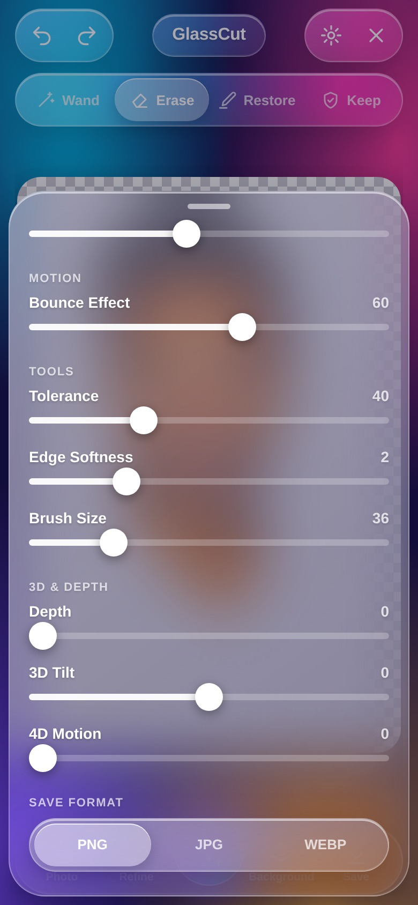
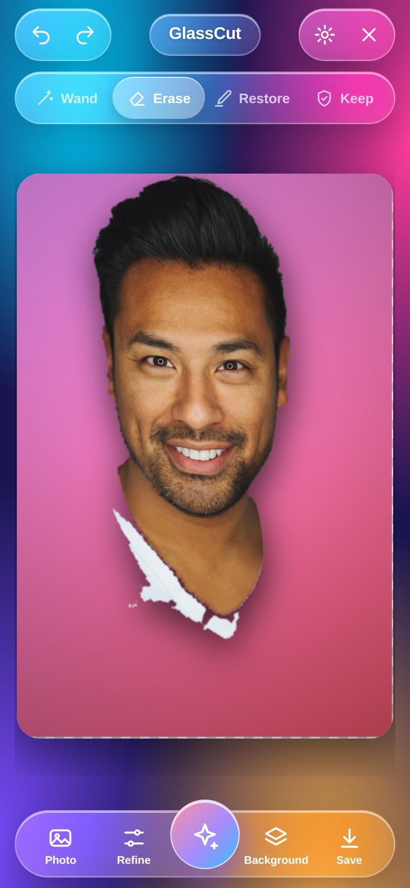
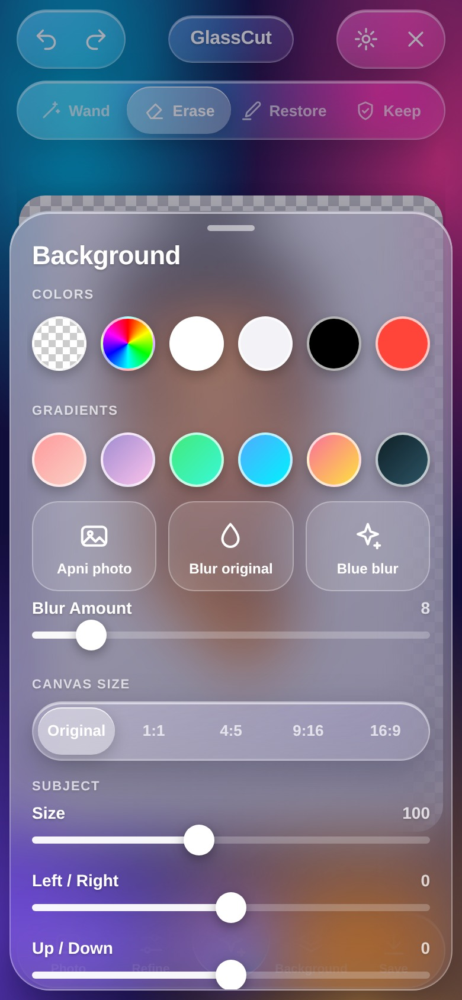
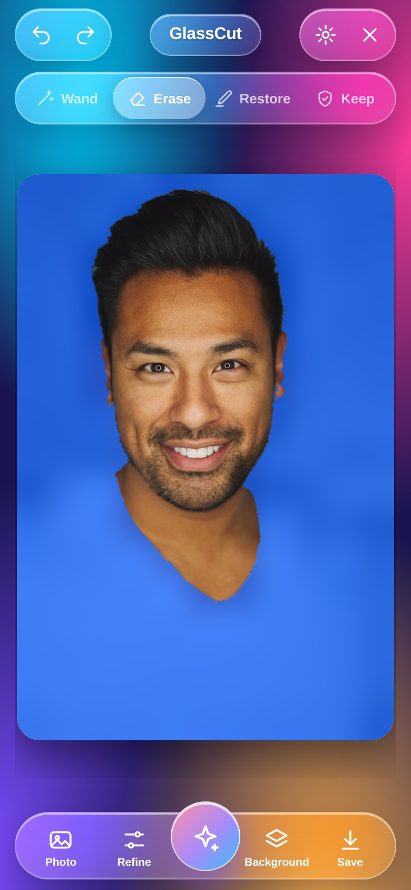
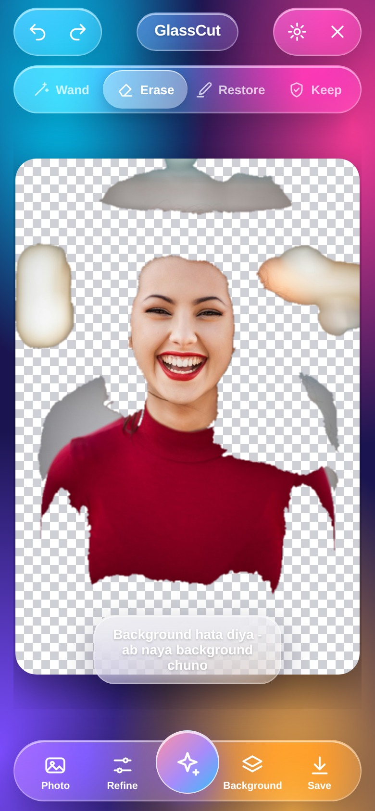
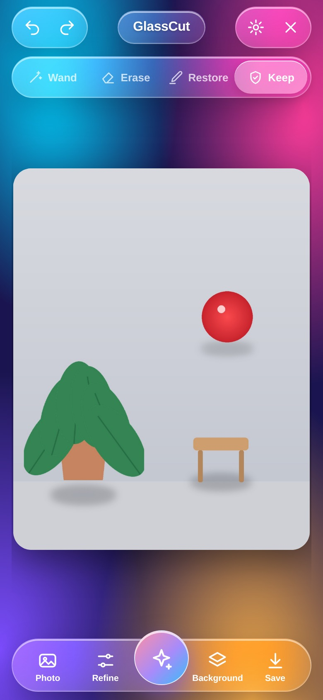
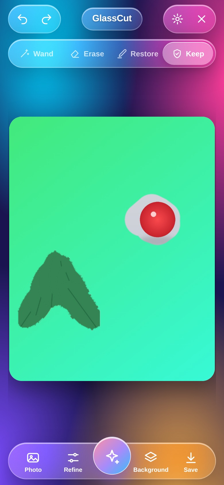

# GlassCut

A liquid-glass background remover for Android. One HTML file is the entire app; the APK is a thin WebView shell that adds the two things a browser tab can't do — a real photo picker and a real *save to gallery*.

Everything runs on the device. No uploads, no accounts, no ads, and the APK asks for **no internet permission at all**.

| | |
|---|---|
| **APK** | [`GlassCut.apk`](GlassCut.apk) — signed, 210 KB, Android 7.0+ |
| **Web app** | [`index.html`](index.html) — open it in any browser, no build step |
| **Package** | `com.glasscut.app` |
| **Version** | 1.1.18 (versionCode 18) |

---

## What it does

Cut a person or object out of a photo, then put it on a colour, a gradient, a blurred version of the original, or another photo of your own.

- **Auto runs by itself** — pick a photo and the background is already gone; open Background and choose. The Auto button is there if you want to run it again after changing tolerance. Finds the background from the border, floods it out, and snaps the edge back at full resolution. Objects standing in the background (a chair, a plant, a second person) stay — see [Objects inside the background](#objects-inside-the-background).
- **Wand** — tap any colour to knock it out (tolerance adjustable).
- **Erase / Restore / Keep** — paint with a finger, brush size up to 140 px. **Keep** protects an object so nothing can remove it.
- **Edge Grow / Shrink / Smooth** — fix a halo or a ragged cut.
- **Subject controls** — size, position, opacity, flip, white outline, drop shadow.
- **Canvas sizes** — original, 1:1, 4:5, 9:16, 16:9.
- **Save** — PNG (transparent), JPG or WEBP, straight into `Pictures/GlassCut`.
- **Glass UI** — transparency, blur and bounce are real sliders, not decoration.
- **Hinglish / English** — the whole UI switches, and the choice is remembered.

Undo/redo is 15 steps deep, and `Ctrl/⌘ + Z`, `Ctrl/⌘ + Y`, `Esc` work on desktop. Drag-and-drop or paste an image into the page on desktop.

## Screenshots

| Empty | Photo loaded | Auto cutout |
|---|---|---|
|  |  |  |

| Background sheet | Gradient applied | Remove tools |
|---|---|---|
|  |  |  |

| Options | Final render | Saved |
|---|---|---|
|  |  |  |

---

## What was broken, and what changed

The starting point was a single HTML file that looked finished but didn't work end to end. The design is untouched — same layout, same glass, same springs. Everything below is logic.

### Save was fake
The old `save()` called `window.claude.use('downloads')` — an API that only exists inside one particular preview environment. Everywhere else it silently fell through to an overlay that told you to *long-press the image and save it manually*. No file was ever written.

| Before | After |
|---|---|
|  |  |

Now `save()` picks the best real path in order:

1. `GlassCutAndroid.saveImage()` — the APK writes into the gallery through MediaStore (`Pictures/GlassCut`), with a storage-permission request on Android 7–9.
2. Web Share API on phones, so iOS Safari can put the file in Photos.
3. A normal `<a download>` blob download on desktop.
4. The long-press overlay only if all three are unavailable — which is now rare.

It also falls back to PNG if the browser refuses `image/webp`, instead of failing with "Save nahi hua".

### Auto-removal left half the background behind
The old algorithm compared every pixel to one fixed colour with a single tolerance. On a portrait with a blurred backdrop it removed the flat areas and left every bokeh blob floating in the cutout.

The new cutout is coarse-to-fine:

1. Downscale 4× — a blurred background collapses into one nearly uniform colour.
2. Flood the border colour model at low resolution, then **drop leftover islands**: any foreground blob smaller than half the largest one becomes background again.
3. Upsample the mask and run a **level-limited flood at full resolution** (max 7 px) so the edge snaps to the real pixel boundary instead of the blocky 4× version.

Opaque pixel coverage on the same test photo: **70 % → 31 %**, with the subject intact and no bokeh left over.

| Before | After |
|---|---|
|  |  |

## Objects inside the background

The first version kept only the **largest** blob and threw away every other island it found. On a photo with a plant, a stool and a ball, the plant survived and everything else vanished — the exact thing a background remover must not do.

1.0.1 keeps them. Two changes:

1. **A second flood pass at 1.7× tolerance**, seeded from the background that was already removed. Shadowed patches, bokeh rims and other off-shade pieces of the *same* background get absorbed, because they sit within reach of a background colour.
2. **A smarter island rule.** Under the new *Objects bachao* switch (on by default) an island is only dropped when it is a speck (under 0.15% of the photo) or when its average colour is within 1.15× tolerance of a background colour — i.e. it really is leftover background. Anything else survives, whatever its size or position.

| 1.0.0 — only the plant survived | 1.0.1 — everything survived |
|---|---|
|  |  |

And once the background is gone, the new one goes behind **every** object, not just the main subject:


**The switch.** *Refine → Objects bachao*. Leave it on and the app keeps everything that isn't background; turn it off for the old behaviour, where only the main subject is kept. Turn it off for portraits where you only want the person and the bokeh behind them can go. The switch lives in the Refine sheet, so the top bar and the dock are unchanged.


## 3D tilt, depth and 4D motion

Three new sliders under **Options → 3D & Depth**. All three are baked into the saved file, not just the preview.

| Control | What it actually does |
|---|---|
| **Depth** 0–100 | Subject scales up to +7%, the drop shadow deepens and moves, and a radial vignette darkens the background. This is what makes the person read as a separate layer instead of a sticker. |
| **3D Tilt** −30…+30 | A perspective shear around the subject's own centre — a vertical-axis rotation, `cos` on the horizontal scale plus a `sin` shear, so it reads as 3D rather than as a skew. |
| **4D Motion** 0–100 | Live parallax. The subject layer and the background move in opposite directions. Driven by `deviceorientation` when the phone reports it, otherwise a slow automatic sway. Runs at ~16 fps so it costs nothing while you edit. |

| 3D & Depth controls | Result with depth 78, tilt 20, motion 60 |
|---|---|
|  |  |

Save captures whatever the effect is showing at that moment, so the exported PNG/JPG has the tilt, shadow and vignette in it.

## Blue blur — one tap, only the person

The quickest result in the app, and the one that survives a bad cutout.

**Background → Blue blur.** It does three things at once:

1. Sets the blur amount to 48 — a 1/79 downscale, so the original background becomes an unreadable wash.
2. Lays a strong blue tint (`#0a5cff` at 72%) over it.
3. Switches to subject-only mode and re-cuts, so leftover background islands are dropped instead of floating in the blue.

| Background sheet | Result |
|---|---|
|  |  |

The Blur Amount slider now goes to **60** instead of 20, so "Blur original" can also be pushed until nothing is recognisable — without the blue.

Save works the same as always: PNG, JPG or WEBP into `Pictures/GlassCut`.

## Background change is automatic

The complaint that started 1.0.3: *pick an image, change its background, and leave the person exactly as they are.* Two things were in the way.

**Auto did not run on its own.** You had to press Auto before the Background sheet did anything — until then the new background was painted *behind an opaque photo*, so nothing appeared to change. Now the cutout runs the moment a photo loads. Pick photo → background already gone → open Background → pick a colour, gradient, blur or your own image. One tap, and the person is untouched.



**The edge was being eaten.** The final edge-snapping pass could creep 7 px into the subject at a soft boundary, which is what chewed hair and left a white halo around faces. It is now capped at 3 px with a tighter colour step, and the coarse pass runs at half resolution instead of a quarter.

| before 1.0.3 — halo, chewed edge | 1.0.3 — clean edge |
|---|---|
|  |  |

**What still needs a hand.** If the subject's hair or clothing is almost the same colour as the background, no colour-based flood can tell them apart — that is a job for the **Keep** brush: paint the hair once, press Auto, done. Honest limit, not a bug.

### The Keep brush — the guaranteed one

Automatic removal is a guess. *Keep* is not. Paint over anything with the Keep tool and it is locked: the flood cannot cross it, Auto cannot take it, Grow/Shrink/Invert/Smooth all respect it. It survives even at maximum tolerance.

| Keep selected, painted over the object | Auto at tolerance 110 — object survives, everything else gone |
|---|---|
|  |  |

What you paint stays, halo included — so paint tight. If you painted too much, switch to **Erase** and go over the extra: erasing clears the protection as well as the pixels. Keep strokes are part of the undo history, so `Undo` takes the protection back too.

**How to use it for your case:** Keep the object → Auto → the object and its own edges are untouched → *Background* → pick a colour, gradient or photo. The new background goes behind the object.

Honest limitation: a soft out-of-focus highlight and a soft-edged object look identical to a pixel test. With the switch **on**, an out-of-focus highlight in the background is kept, because the app would rather keep an object than delete one. Tap it away with the Wand — that is what the Wand is for.

### Smaller fixes

- **Undo/redo could corrupt state** — the edge-smooth pass read from the live mask while writing to it.
- **Canvas upscaling** — picking a crop ratio forced a 1400 px canvas even for a small photo, so the subject went soft. The canvas is now capped at the photo's own long edge.
- **Brush ring was the wrong size** — it was drawn in screen pixels from an image-pixel radius, so it ballooned on small canvases. It now tracks the live zoom.
- **Wand left an empty undo step** when nothing matched, so one tap of Undo appeared to do nothing.
- **Blur background re-rendered every frame** — now cached by canvas size and blur amount.
- **Language toggle ate whitespace** — text nodes were replaced with trimmed strings, shifting the layout on every switch. Only the words are swapped now.
- **Pointer capture was never released**, so a stroke could stick after leaving the canvas; `pointerleave` now ends it.
- **Memory** — undo history trimmed to 15 full-resolution masks.
- **Objects in the background were deleted** — the island filter kept only the biggest blob. Fixed in 1.0.1, see above.
- **Safe areas** — the page reads `--sat` / `--sab` CSS variables, which the Android shell feeds from real window insets, so the header clears a notch and the dock clears the gesture bar.

Verified in headless Chrome: load → auto → wand → erase → undo → redo → reset → re-cut → save → language switch → close, with zero console errors, and the saved file checked on disk.

---

## Install the APK

Download [`GlassCut.apk`](GlassCut.apk) on the phone, tap it, allow "install unknown apps" for your browser or file manager once. Android 7.0 (API 24) or newer.

**This build has a new signing key again** — `/scratch/saved` was empty when the 1.1.18 build sandbox came up, so `build.sh` generated a fresh keystore. Android will refuse to install it over any earlier build — uninstall the old app once, then install. The keystore is deliberately *not* committed (a signing key is a credential); this run's key is handed back as `glasscut-signing-key.jks` so it can be dropped at `/scratch/saved/glasscut-signing-key.jks`, and every later build in this workspace will reuse it. Self-signed 2048-bit RSA, v1+v2+v3, valid 30 years. SHA-256 of the certificate for this build:

```
4f3ec2d24b30c0b123a9a5451dab9db438caa013baafe84616fc5515bb15a22f
```

## Build it yourself

The APK is built without Gradle — `aapt2`, `javac`, `d8`, `zipalign`, `apksigner` straight from the Android SDK, which keeps the whole toolchain under 300 MB and the build under a minute.

```bash
# needs: JDK 17, Android SDK build-tools 34, platform 34
bash build.sh            # -> GlassCut.apk
```

`build.sh` expects the SDK at `/scratch/work/sdk` and the JDK at `/scratch/work/jdk`; edit the two paths at the top for your machine.

Layout:

```
index.html                      the whole app — UI, canvas engine, mask tools
app/assets/index.html           the same file, shipped inside the APK
app/java/com/glasscut/app/      WebView shell: file chooser + gallery bridge + insets
app/res/                        icons, theme, strings
build.sh                        aapt2 → javac → d8 → zipalign → apksigner
```

### How the shell talks to the page

```js
// page → native
GlassCutAndroid.saveImage(dataUrl, "glasscut-123.png", "image/png");  // "ok:<uri>" | "err:<why>"
GlassCutAndroid.toast("message");

// native → page, on every inset change
document.documentElement.style.setProperty('--sat', '28px');
```

## Licence

MIT. Do what you like with it.

---

## ⭐ Like this work? Give it a star

If you like this app and our work, please **star this repository** ⭐ and **[follow technicalnihilist-lgtm on GitHub](https://github.com/technicalnihilist-lgtm)**. If our work isn't for you, that's completely fine — the choice is yours. Thank you for stopping by!

<details>
<summary><b>🌍 Same message in 32 languages (A–Z + Indian languages)</b></summary>

- **A — Arabic** (العربية): ⭐ إذا أعجبك هذا التطبيق وعملنا، فيرجى منح المستودع نجمة ومتابعتنا. وإذا لم يعجبك عملنا، فلا مشكلة على الإطلاق — القرار قرارك. شكرًا لزيارتك!
- **B — Bengali** (বাংলা): ⭐ যদি আপনার এই অ্যাপ এবং আমাদের কাজ ভালো লাগে, তবে অনুগ্রহ করে রিপোজিটরিটিকে একটি স্টার দিন এবং আমাদের ফলো করুন। আমাদের কাজ যদি আপনার পছন্দ না হয়, তাতেও কোনো সমস্যা নেই — সিদ্ধান্ত আপনার। আমাদের পেজে আসার জন্য ধন্যবাদ!
- **C — Chinese** (中文): ⭐ 如果你喜欢这个应用和我们的作品，请给仓库点个星标并关注我们。如果我们的作品不适合你，也完全没关系——选择权在你。感谢你的到访！
- **D — Dutch** (Nederlands): ⭐ Vind je deze app en ons werk leuk? Geef de repository dan een ster en volg ons. Vind je ons werk niets, dan is dat helemaal prima — de keuze is aan jou. Bedankt voor je bezoek!
- **E — English** (English): ⭐ If you like this app and our work, please give the repository a star and follow us. If our work isn't for you, that's completely fine — the choice is yours. Thank you for stopping by!
- **F — French** (Français): ⭐ Si cette application et notre travail vous plaisent, mettez une étoile au dépôt et suivez-nous. Si notre travail n'est pas pour vous, aucun souci — c'est votre choix. Merci de votre visite !
- **G — German** (Deutsch): ⭐ Wenn dir diese App und unsere Arbeit gefallen, gib dem Repository einen Stern und folge uns. Wenn unsere Arbeit nichts für dich ist, ist das völlig in Ordnung — die Wahl liegt bei dir. Danke fürs Vorbeischauen!
- **H — Hindi** (हिन्दी): ⭐ अगर आपको यह ऐप और हमारा काम पसंद है, तो कृपया रिपॉजिटरी को स्टार दें और हमें फॉलो करें। अगर हमारा काम आपके लिए नहीं है, तो भी कोई बात नहीं — यह पूरी तरह आपकी मर्ज़ी है। यहाँ आने के लिए आपका धन्यवाद!
- **I — Indonesian** (Bahasa Indonesia): ⭐ Jika kamu suka aplikasi ini dan karya kami, beri bintang pada repositori ini dan ikuti kami. Kalau karya kami bukan untukmu, tidak masalah sama sekali — itu pilihanmu. Terima kasih sudah mampir!
- **J — Japanese** (日本語): ⭐ このアプリと私たちの仕事が気に入ったら、リポジトリにスターを付けてフォローしてください。合わない場合はまったく問題ありません — 選ぶのはあなたです。お越しいただきありがとうございます！
- **K — Korean** (한국어): ⭐ 이 앱과 저희 작업이 마음에 드신다면 저장소에 스타를 눌러 주시고 팔로우해 주세요. 저희 작업이 맞지 않으셔도 전혀 괜찮습니다 — 선택은 여러분의 몫입니다. 방문해 주셔서 감사합니다!
- **L — Lithuanian** (Lietuvių): ⭐ Jei tau patinka ši programa ir mūsų darbas, duok saugyklai žvaigždutę ir sek mus. Jei mūsų darbas ne tau, viskas gerai — pasirinkimas tavo. Ačiū, kad užsukai!
- **M — Malayalam** (മലയാളം): ⭐ നിങ്ങൾക്ക് ഈ ആപ്പും ഞങ്ങളുടെ പ്രവർത്തനവും ഇഷ്ടപ്പെട്ടെങ്കിൽ, ദയവായി റെപ്പോസിറ്ററിക്ക് ഒരു സ്റ്റാർ നൽകുകയും ഞങ്ങളെ ഫോളോ ചെയ്യുകയും ചെയ്യുക. ഞങ്ങളുടെ പ്രവർത്തനം നിങ്ങൾക്ക് അനുയോജ്യമല്ലെങ്കിൽ, അതും തികച്ചും കുഴപ്പമില്ല — തീരുമാനം നിങ്ങളുടേതാണ്. ഇവിടെ വന്നതിന് നന്ദി!
- **N — Nepali** (नेपाली): ⭐ यदि तपाईंलाई यो एप र हाम्रो काम मन पर्‍यो भने, कृपया रिपोजिटरीलाई स्टार दिनुहोस् र हामीलाई फलो गर्नुहोस्। यदि हाम्रो काम तपाईंलाई मन पर्दैन भने, पनि ठीकै छ — यो तपाईंको इच्छा हो। यहाँ आउनुभएकोमा धन्यवाद!
- **O — Odia** (ଓଡ଼ିଆ): ⭐ ଯଦି ଆପଣଙ୍କୁ ଏହି ଆପ୍ ଏବଂ ଆମର କାମ ଭଲ ଲାଗୁଛି, ତେବେ ଦୟାକରି ରିପୋଜିଟୋରୀକୁ ଗୋଟିଏ ଷ୍ଟାର୍ ଦିଅନ୍ତୁ ଏବଂ ଆମକୁ ଫଲୋ କରନ୍ତୁ। ଯଦି ଆମର କାମ ଆପଣଙ୍କ ପାଇଁ ନୁହେଁ, ତେବେ କିଛି ଅସୁବିଧା ନାହିଁ — ପସନ୍ଦ ଆପଣଙ୍କର। ଆମ ପାଖକୁ ଆସିଥିବାରୁ ଧନ୍ୟବାଦ!
- **P — Polish** (Polski): ⭐ Jeśli podoba Ci się ta aplikacja i nasza praca, daj repozytorium gwiazdkę i obserwuj nas. Jeśli nasza praca nie jest dla Ciebie, to zupełnie w porządku — wybór należy do Ciebie. Dziękujemy za odwiedziny!
- **Q — Quechua** (Runa Simi): ⭐ Kay app, ñuqaykup ruwasqanchikpas gustasunki chayqa, repositorioman huk estrella churay, ñuqaykutapas qatipayku. Mana gustasunki chayqa, allinmi — qampa akllayki. Hamusqaykimanta sulpayki!
- **R — Russian** (Русский): ⭐ Если вам нравится это приложение и наша работа, поставьте звёздочку репозиторию и подпишитесь на нас. Если наша работа не для вас — это совершенно нормально, выбор за вами. Спасибо, что заглянули!
- **S — Spanish** (Español): ⭐ Si te gusta esta app y nuestro trabajo, dale una estrella al repositorio y síguenos. Si nuestro trabajo no es para ti, no pasa nada — la decisión es tuya. ¡Gracias por pasarte!
- **T — Tamil** (தமிழ்): ⭐ உங்களுக்கு இந்த ஆப்பும் எங்க வேலையும் பிடிச்சிருந்தா, தயவுசெஞ்சு இந்த ரெபாசிட்டரிக்கு ஒரு ஸ்டார் குடுத்து, எங்களை ஃபாலோ பண்ணுங்க. எங்க வேலை உங்களுக்கு செட் ஆகலைன்னாலும் பரவாயில்லை — அது உங்க விருப்பம். இங்கே வந்ததுக்கு நன்றி!
- **U — Urdu** (اردو): ⭐ اگر آپ کو یہ ایپ اور ہمارا کام پسند آئے تو براہ کرم ریپازٹری کو سٹار دیں اور ہمیں فالو کریں۔ اگر ہمارا کام آپ کے لیے نہیں ہے، تو یہ بالکل ٹھیک ہے — انتخاب آپ کا ہے۔ یہاں تشریف لانے کا شکریہ!
- **V — Vietnamese** (Tiếng Việt): ⭐ Nếu bạn thích ứng dụng này và công việc của chúng tôi, hãy tặng kho lưu trữ một ngôi sao và theo dõi chúng tôi. Nếu công việc của chúng tôi không phù hợp với bạn, điều đó hoàn toàn ổn — lựa chọn là của bạn. Cảm ơn bạn đã ghé qua!
- **W — Welsh** (Cymraeg): ⭐ Os ydych chi'n hoffi'r ap hwn a'n gwaith, rhowch seren i'r storfa a dilynwch ni. Os nad yw ein gwaith ar eich cyfer, mae hynny'n hollol iawn — chi sydd i benderfynu. Diolch am alw heibio!
- **X — Xhosa** (isiXhosa): ⭐ Ukuba uyayithanda le app nomsebenzi wethu, nika irepo inkwenkwezi kwaye usilandele. Ukuba umsebenzi wethu awukufanelanga, akukho ngxaki — lukhetho lwakho. Enkosi ngokutyelela!
- **Y — Yoruba** (Yorùbá): ⭐ Bí app yìí àti iṣẹ́ wa bá wù ọ́, jọ̀wọ́ fún àkójọpọ̀ náà ní ìràwọ̀ kí o sì tẹ̀lé wa. Bí iṣẹ́ wa kò bá yẹ ọ́, kò séwu — ìwọ ni ó yàn. Ẹ ṣé fún wíwá!
- **Z — Zulu** (isiZulu): ⭐ Uma uthanda le app nomsebenzi wethu, nikeza isitoreji inkanyezi bese usilandela. Uma umsebenzi wethu ungakufanele, akunankinga — wukukhetha kwakho. Siyabonga ngokuvakasha!

**More Indian languages**

- **Assamese** (অসমীয়া): ⭐ যদি আপুনি এই এপটো আৰু আমাৰ কাম ভাল পায়, তেন্তে অনুগ্ৰহ কৰি ৰিপজিটৰীটোক এটা ষ্টাৰ দিয়ক আৰু আমাক ফ'ল' কৰক। যদি আমাৰ কাম আপোনাৰ বাবে নহয়, তেন্তে সেয়া একেবাৰে ঠিক আছে — সিদ্ধান্তটো আপোনাৰ। আমাৰ ইয়ালৈ অহাৰ বাবে ধন্যবাদ!
- **Gujarati** (ગુજરાતી): ⭐ જો તમને આ એપ અને અમારું કામ ગમતું હોય, તો પ્લીઝ રિપોઝિટરીને સ્ટાર આપો અને અમને ફોલો કરો. જો અમારું કામ તમને ન ગમતું હોય, તો તે પણ બરાબર છે — પસંદગી તમારી છે. અહીં આવવા બદલ આભાર!
- **Kannada** (ಕನ್ನಡ): ⭐ ನಿಮಗೆ ಈ ಆ್ಯಪ್ ಮತ್ತು ನಮ್ಮ ಕೆಲಸ ಇಷ್ಟವಾದರೆ, ದಯವಿಟ್ಟು ರೆಪೊಸಿಟರಿಗೆ ಸ್ಟಾರ್ ಕೊಡಿ ಮತ್ತು ನಮ್ಮನ್ನು ಫಾಲೋ ಮಾಡಿ. ನಮ್ಮ ಕೆಲಸ ನಿಮಗೆ ಸರಿಹೊಂದದಿದ್ದರೆ, ಅದೂ ಪರವಾಗಿಲ್ಲ — ಆಯ್ಕೆ ನಿಮ್ಮದು. ಭೇಟಿ ನೀಡಿದ್ದಕ್ಕೆ ಧನ್ಯವಾದಗಳು!
- **Marathi** (मराठी): ⭐ जर तुम्हाला हे ॲप आणि आमचं काम आवडलं असेल, तर कृपया रिपॉझिटरीला स्टार द्या आणि आम्हाला फॉलो करा. जर आमचं काम तुम्हाला आवडत नसेल, तर काही हरकत नाही — ती तुमची निवड आहे. इथे आल्याबद्दल धन्यवाद!
- **Punjabi** (ਪੰਜਾਬੀ): ⭐ ਜੇ ਤੁਹਾਨੂੰ ਇਹ ਐਪ ਅਤੇ ਸਾਡਾ ਕੰਮ ਪਸੰਦ ਹੈ, ਤਾਂ ਕਿਰਪਾ ਕਰਕੇ ਰਿਪੋਜ਼ਟਰੀ ਨੂੰ ਸਟਾਰ ਦਿਓ ਅਤੇ ਸਾਨੂੰ ਫਾਲੋ ਕਰੋ। ਜੇ ਸਾਡਾ ਕੰਮ ਤੁਹਾਡੇ ਲਈ ਨਹੀਂ ਹੈ, ਤਾਂ ਕੋਈ ਗੱਲ ਨਹੀਂ — ਚੋਣ ਤੁਹਾਡੀ ਹੈ। ਸਾਡੇ ਪੇਜ 'ਤੇ ਆਉਣ ਲਈ ਧੰਨਵਾਦ!
- **Telugu** (తెలుగు): ⭐ మీకు ఈ యాప్, మా పని నచ్చితే, దయచేసి రిపోజిటరీకి ఒక స్టార్ ఇచ్చి మమ్మల్ని ఫాలో అవ్వండి. ఒకవేళ మా పని మీకు నచ్చకపోతే, పర్వాలేదు — అది మీ ఇష్టం. మమ్మల్ని సందర్శించినందుకు ధన్యవాదాలు!

</details>
