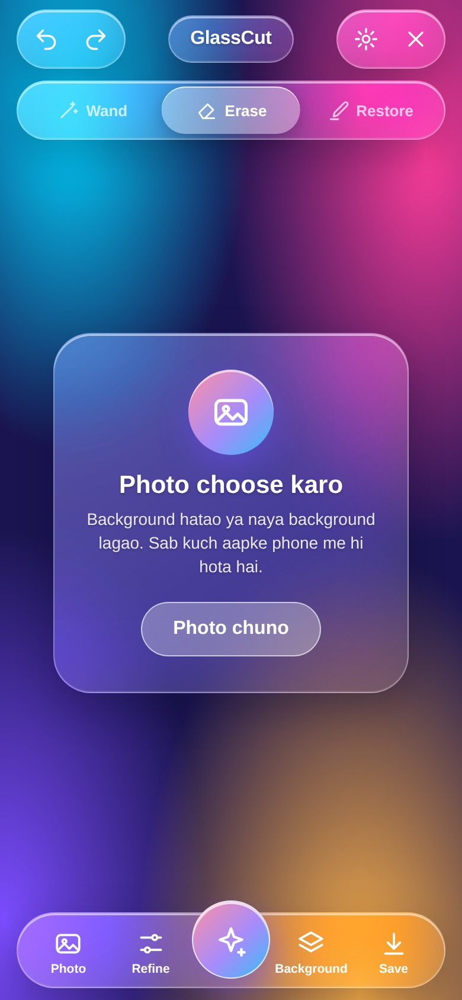
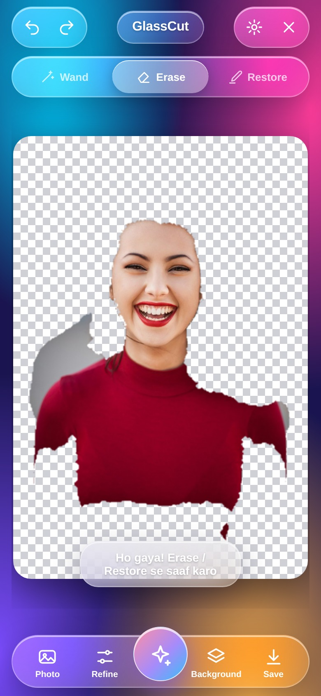
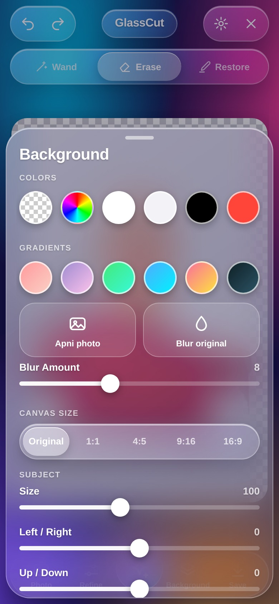
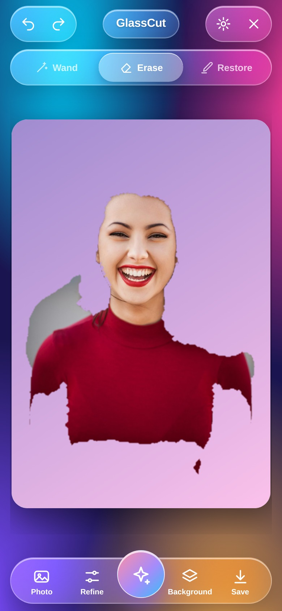
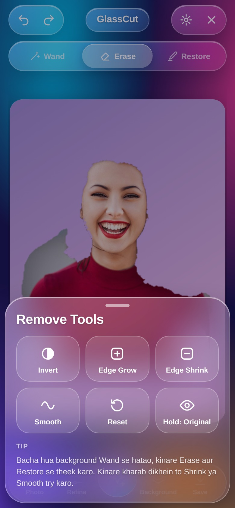
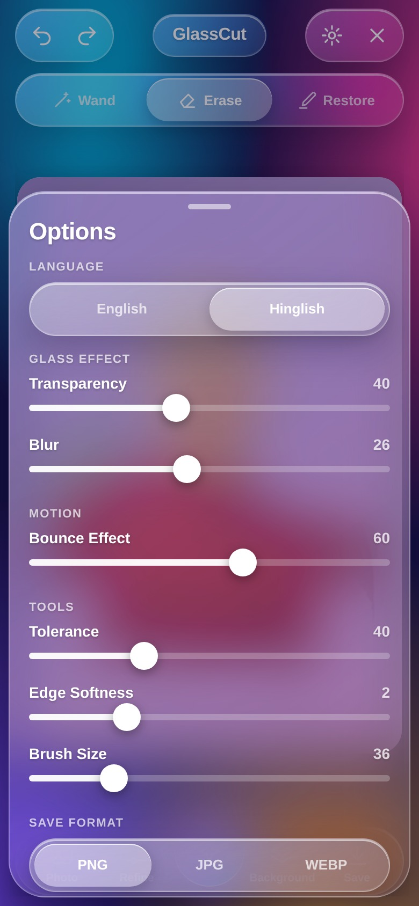
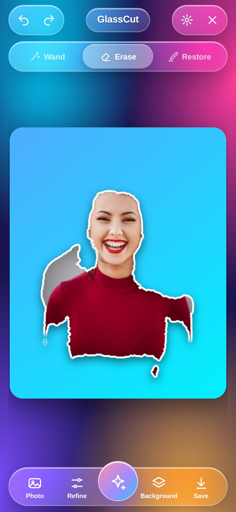
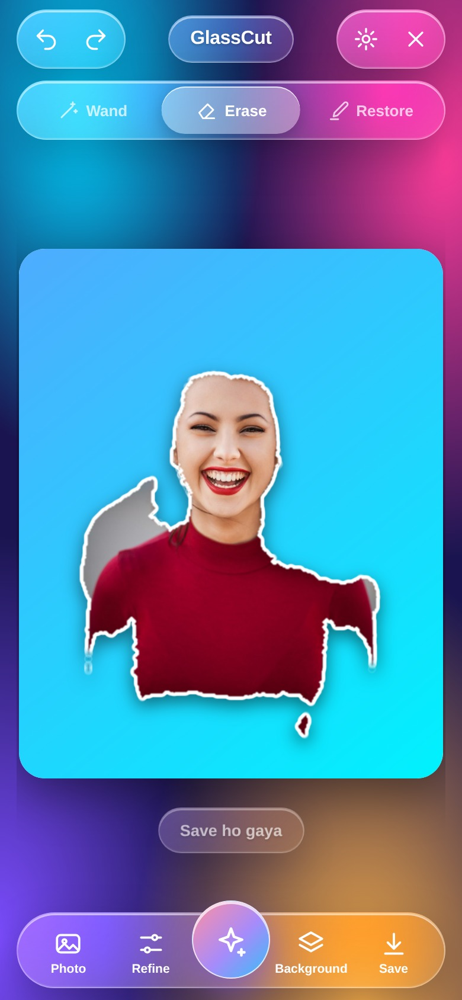
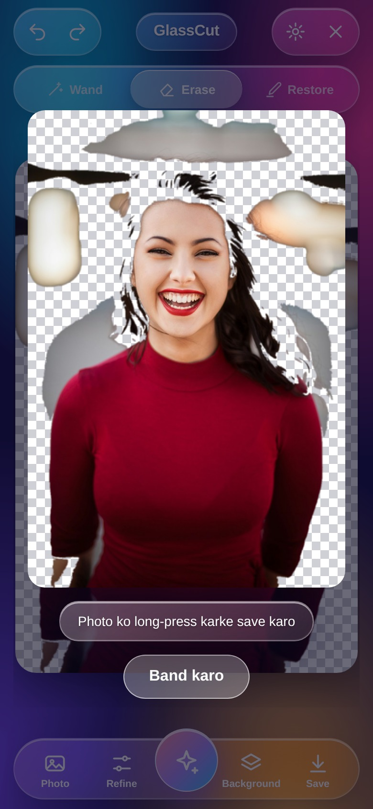
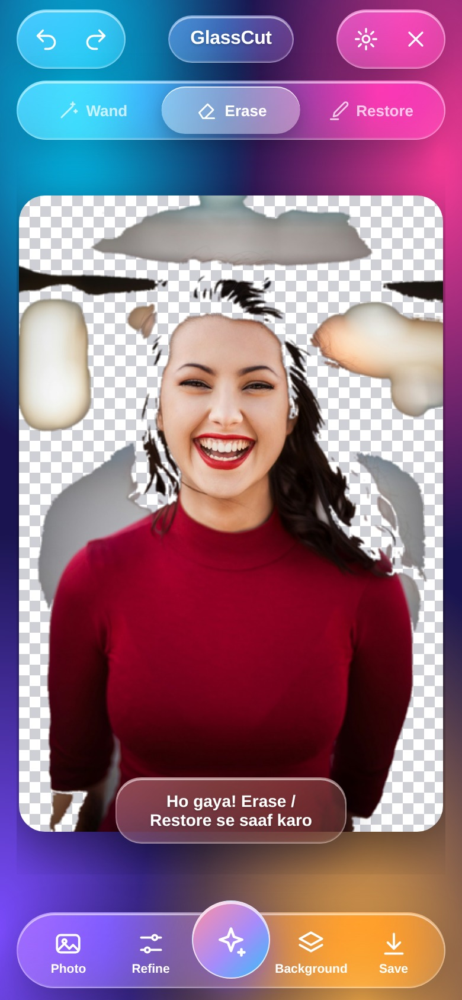

# GlassCut

A liquid-glass background remover for Android. One HTML file is the entire app; the APK is a thin WebView shell that adds the two things a browser tab can't do — a real photo picker and a real *save to gallery*.

Everything runs on the device. No uploads, no accounts, no ads, and the APK asks for **no internet permission at all**.

| | |
|---|---|
| **APK** | [`GlassCut.apk`](GlassCut.apk) — signed, 202 KB, Android 7.0+ |
| **Web app** | [`index.html`](index.html) — open it in any browser, no build step |
| **Package** | `com.glasscut.app` |
| **Version** | 1.0.0 (versionCode 1) |

---

## What it does

Cut a person or object out of a photo, then put it on a colour, a gradient, a blurred version of the original, or another photo of your own.

- **Auto** — one tap. Finds the background from the border, floods it out, and snaps the edge back at full resolution.
- **Wand** — tap any colour to knock it out (tolerance adjustable).
- **Erase / Restore** — paint with a finger, brush size up to 140 px.
- **Edge Grow / Shrink / Smooth** — fix a halo or a ragged cut.
- **Subject controls** — size, position, opacity, flip, white outline, drop shadow.
- **Canvas sizes** — original, 1:1, 4:5, 9:16, 16:9.
- **Save** — PNG (transparent), JPG or WEBP, straight into `Pictures/GlassCut`.
- **Glass UI** — transparency, blur and bounce are real sliders, not decoration.
- **Hinglish / English** — the whole UI switches, and the choice is remembered.

Undo/redo is 15 steps deep, and `Ctrl/⌘ + Z`, `Ctrl/⌘ + Y`, `Esc` work on desktop. Drag-and-drop or paste an image into the page on desktop.

## Screenshots

| Empty | Photo loaded | Auto cutout |
|---|---|---|
|  |  |  |

| Background sheet | Gradient applied | Remove tools |
|---|---|---|
|  |  |  |

| Options | Final render | Saved |
|---|---|---|
|  |  |  |

---

## What was broken, and what changed

The starting point was a single HTML file that looked finished but didn't work end to end. The design is untouched — same layout, same glass, same springs. Everything below is logic.

### Save was fake
The old `save()` called `window.claude.use('downloads')` — an API that only exists inside one particular preview environment. Everywhere else it silently fell through to an overlay that told you to *long-press the image and save it manually*. No file was ever written.

| Before | After |
|---|---|
|  |  |

Now `save()` picks the best real path in order:

1. `GlassCutAndroid.saveImage()` — the APK writes into the gallery through MediaStore (`Pictures/GlassCut`), with a storage-permission request on Android 7–9.
2. Web Share API on phones, so iOS Safari can put the file in Photos.
3. A normal `<a download>` blob download on desktop.
4. The long-press overlay only if all three are unavailable — which is now rare.

It also falls back to PNG if the browser refuses `image/webp`, instead of failing with "Save nahi hua".

### Auto-removal left half the background behind
The old algorithm compared every pixel to one fixed colour with a single tolerance. On a portrait with a blurred backdrop it removed the flat areas and left every bokeh blob floating in the cutout.

The new cutout is coarse-to-fine:

1. Downscale 4× — a blurred background collapses into one nearly uniform colour.
2. Flood the border colour model at low resolution, then **drop leftover islands**: any foreground blob smaller than half the largest one becomes background again.
3. Upsample the mask and run a **level-limited flood at full resolution** (max 7 px) so the edge snaps to the real pixel boundary instead of the blocky 4× version.

Opaque pixel coverage on the same test photo: **70 % → 31 %**, with the subject intact and no bokeh left over.

| Before | After |
|---|---|
|  |  |

### Smaller fixes

- **Undo/redo could corrupt state** — the edge-smooth pass read from the live mask while writing to it.
- **Canvas upscaling** — picking a crop ratio forced a 1400 px canvas even for a small photo, so the subject went soft. The canvas is now capped at the photo's own long edge.
- **Brush ring was the wrong size** — it was drawn in screen pixels from an image-pixel radius, so it ballooned on small canvases. It now tracks the live zoom.
- **Wand left an empty undo step** when nothing matched, so one tap of Undo appeared to do nothing.
- **Blur background re-rendered every frame** — now cached by canvas size and blur amount.
- **Language toggle ate whitespace** — text nodes were replaced with trimmed strings, shifting the layout on every switch. Only the words are swapped now.
- **Pointer capture was never released**, so a stroke could stick after leaving the canvas; `pointerleave` now ends it.
- **Memory** — undo history trimmed to 15 full-resolution masks.
- **Safe areas** — the page reads `--sat` / `--sab` CSS variables, which the Android shell feeds from real window insets, so the header clears a notch and the dock clears the gesture bar.

Verified in headless Chrome: load → auto → wand → erase → undo → redo → reset → re-cut → save, with zero console errors, and the saved file checked on disk.

---

## Install the APK

Download [`GlassCut.apk`](GlassCut.apk) on the phone, tap it, allow "install unknown apps" for your browser or file manager once. Android 7.0 (API 24) or newer.

Signed with a self-signed 2048-bit RSA key, v1+v2+v3 signatures, validity 30 years. SHA-256 of the certificate:

```
c8a55acee2eecab868c2986c25f8016fb041a418d08ce944fa9d44b03d35b01f
```

## Build it yourself

The APK is built without Gradle — `aapt2`, `javac`, `d8`, `zipalign`, `apksigner` straight from the Android SDK, which keeps the whole toolchain under 300 MB and the build under a minute.

```bash
# needs: JDK 17, Android SDK build-tools 34, platform 34
bash build.sh            # -> GlassCut.apk
```

`build.sh` expects the SDK at `/scratch/work/sdk` and the JDK at `/scratch/work/jdk`; edit the two paths at the top for your machine.

Layout:

```
index.html                      the whole app — UI, canvas engine, mask tools
app/assets/index.html           the same file, shipped inside the APK
app/java/com/glasscut/app/      WebView shell: file chooser + gallery bridge + insets
app/res/                        icons, theme, strings
build.sh                        aapt2 → javac → d8 → zipalign → apksigner
```

### How the shell talks to the page

```js
// page → native
GlassCutAndroid.saveImage(dataUrl, "glasscut-123.png", "image/png");  // "ok:<uri>" | "err:<why>"
GlassCutAndroid.toast("message");

// native → page, on every inset change
document.documentElement.style.setProperty('--sat', '28px');
```

## Licence

MIT. Do what you like with it.
